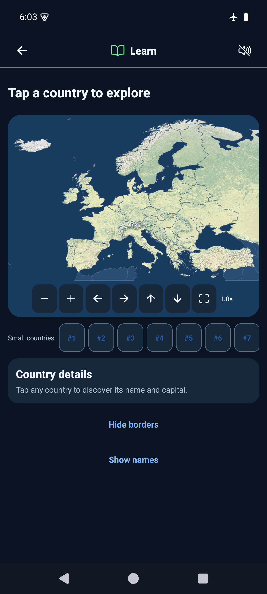
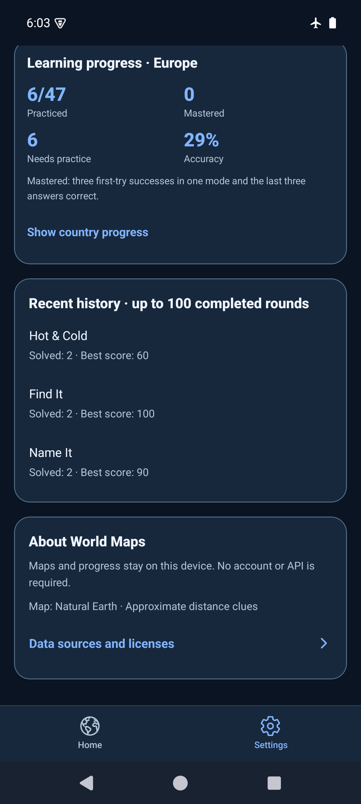

# Cleanup integration review — 2026-10-25

Both cleanup PRs (#24 and #25) were merged into main, while develop advanced.
The two implementation commits were rebased onto develop `4d0b9b6`, retaining
country/capital/flag clues, legacy capital mode IDs, system theme and richer Learn
cards. Quick Challenge is on a separate feature branch and is outside this PR.

## Review findings resolved

- Shared prompts now handle capital/flag variants and legacy capital modes instead
  of falling through the older four-mode helper. Tests cover EN/PL/RU and completion.
- The public Home mode list remains four IDs; stored legacy capital identifiers
  remain accepted. ModeSelector retains develop's system-aware icon colors.
- Emulator review found forced dark status-bar icons on dark screens. The status
  bar now follows the system appearance; the rebuilt APK was visually verified.
- Removed remaining template ownership wording in the workflow and theme comment.

No storage keys or schema changed. Serialized progress recovery, legacy language
fallback, web SVG adapters, speech queue, gesture guard and geography generators /
licenses are retained. No remaining blocking finding was identified in this diff.

## Commands and evidence

- `git fetch --all --prune`: all configured remote refs fetched; develop remained
  `4d0b9b6` on the final fetch.
- `npm ci`: PASS; six high-severity dependency entries remain reported. No forced
  SDK downgrade or unrelated dependency upgrade was applied.
- `npm run ci`: PASS — TypeScript, ESLint, 23 test files / 82 tests.
- `npx expo-doctor`: PASS — 21/21 checks.
- `npx expo export --platform web --output-dir artifacts/cleanup-review-web`: PASS.
- Web at 390×844: four modes, Find It name/capital/flag/mixed entry, both Name It
  answer types, Learn country selection and offline facts, keyboard SVG selection,
  dark appearance and Polish preference after reload checked. Final export keyboard
  selection recorded an attempt with no page error observed.
- `JAVA_HOME=/opt/homebrew/opt/openjdk@17/libexec/openjdk.jdk/Contents/Home
  ANDROID_HOME=/opt/homebrew/share/android-commandlinetools
  ANDROID_SDK_ROOT=/opt/homebrew/share/android-commandlinetools
  WORLD_MAPS_ARCHITECTURES=arm64-v8a npm run build:android:preview`: PASS.
- `adb -s emulator-5554 install -r artifacts/world-maps-preview.apk`: PASS, no
  uninstall or storage clearing. API 35 arm64, World Maps AVD, 1080×2400.
- Existing six practiced countries / 29% accuracy and solved counts 2/2/2 with
  best scores 60/100/90 survived both update installations. English and voice-off
  preference retained. Cold launch remained usable with airplane mode enabled.
- All four modes opened; Android Back returned Home. Learn marker selected Andorra
  and displayed its localized capital and geographic details. Light/gesture and
  dark/three-button layouts checked; light/gesture restored afterwards. Airplane
  mode was already enabled and was left enabled.

## Artifact and limits

APK: `artifacts/world-maps-preview.apk` (ignored local build artifact).
Source: `c24ed9dec7cf24d649bcd7571b5d1a0f6110318a` with no tracked changes at build time.
Subsequent commit adds evidence only.
SHA-256: `2f98313cb77e8b3b50dd02811ea6fd70810c7f5a4e4fdadedf7516f4ea5053ed`.
arm64-v8a, embedded JavaScript, development signing; not a store artifact.

Physical phone, iOS, TalkBack and audible speech are pending. This review does not
repeat full difficulty, pinch/pan or large-font regression. Storage fault injection
is unit-tested; native failure injection was not exercised. Native mode-entry and
Learn-card checks first ran before the status-bar-only rebuild; final APK repeated
offline launch, history retention and dark/inset checks. Build logs retain SDK XML
and Gradle deprecation warnings; build exited successfully.
