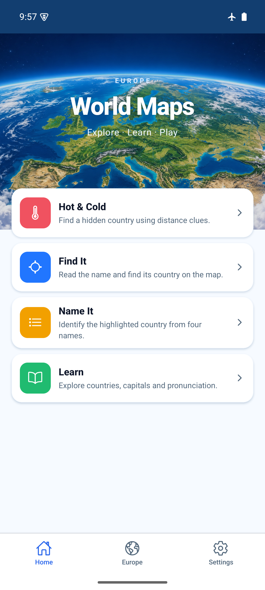
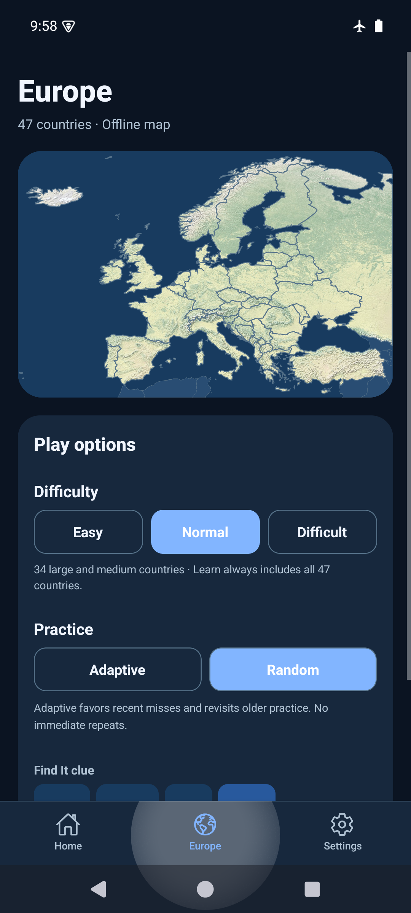

# Europe tab follow-up — 2026-10-26

Home contains four game modes. The former Europe / 47 countries / Offline map
row and play setup now live in a middle tab: Home → Europe → Settings.
Both Home header shortcuts to Settings were removed.

Quiz clue/answer variants are transient state shared by the tab navigator;
difficulty and practice continue to use existing saved preferences. No storage
keys, schema, scored mode IDs or game rules change. Each mounted map uses a unique
SVG clip ID, allowing the Europe preview and Learn map to coexist.

Verification:

- `npm run ci`: PASS — TypeScript, ESLint, 85 tests in 23 files.
- `npx expo-doctor`: PASS — 21/21.
- `npx expo export --platform web --output-dir artifacts/europe-tab-web`: PASS.
- Browser: three-tab order, four Home cards without the extra summary row or header
  shortcuts; capital/flag clues and capital answers carry across tabs; difficulty
  retained; middle tab localized in Polish; tabs hidden during play; preview/Learn
  clip IDs unique and terrain visible.
- `WORLD_MAPS_ARCHITECTURES=arm64-v8a npm run build:android:preview` with JDK 17 and
  the local Android SDK: PASS. `adb -s emulator-5554 install -r
  artifacts/world-maps-preview.apk`: PASS, no uninstall or data clearing.
- API 35 arm64 emulator, 1080×2400: navigation, capital clue from Europe to Find It,
  hidden game tabs, Android Back, Learn terrain and scrollable setup checked.
  Existing score summaries retained (solved 2/3/3, best scores 60/100/90).
- Gesture/light and three-button/dark layouts checked; returning from Europe with
  system Back opens Home. Restored light/gesture settings and Normal difficulty.
  Existing airplane mode remained enabled. No phone or iOS testing claimed.

APK source: `55d4ef11b3a9706c409a67ebc972d1d688a6a778`; clean tracked tree at build time.
SHA-256: `e14bfef3dc81e8a10b1e6ee63556bf7e847c938e313529d7e16bd125d8fa8f67`.
Local artifact: `artifacts/world-maps-preview.apk`, embedded JS, arm64-v8a,
development signing, not a store build. The next commit adds evidence only.

