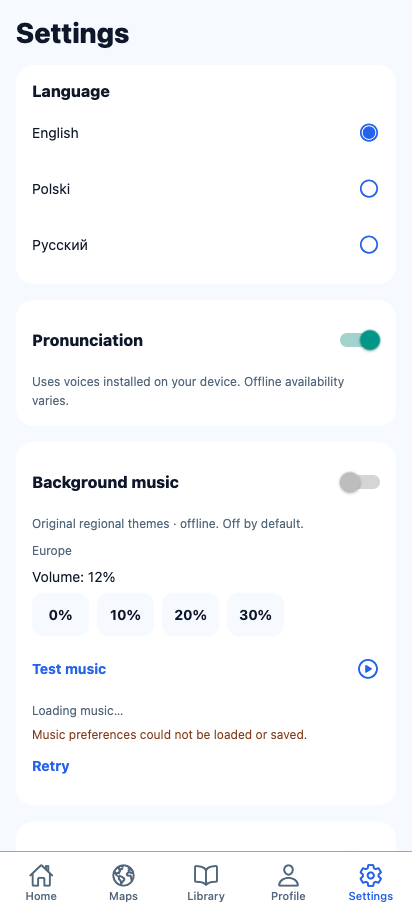
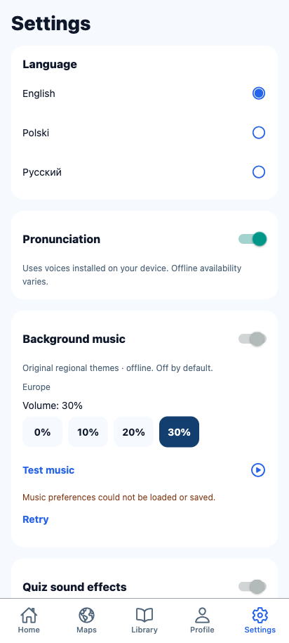
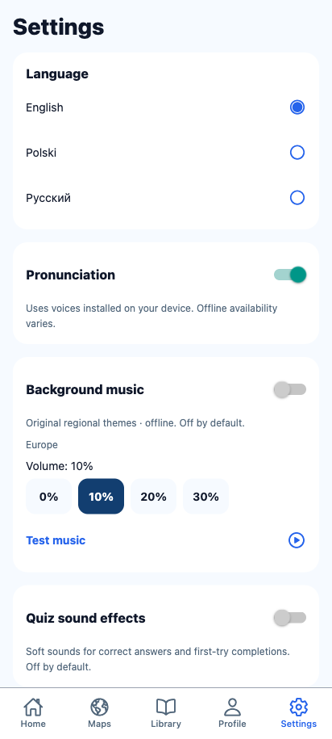
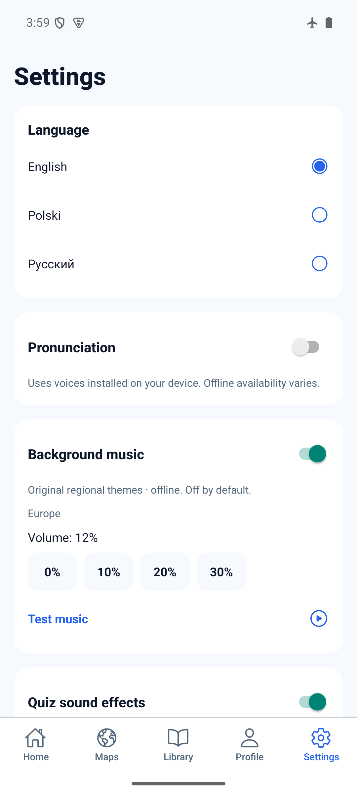
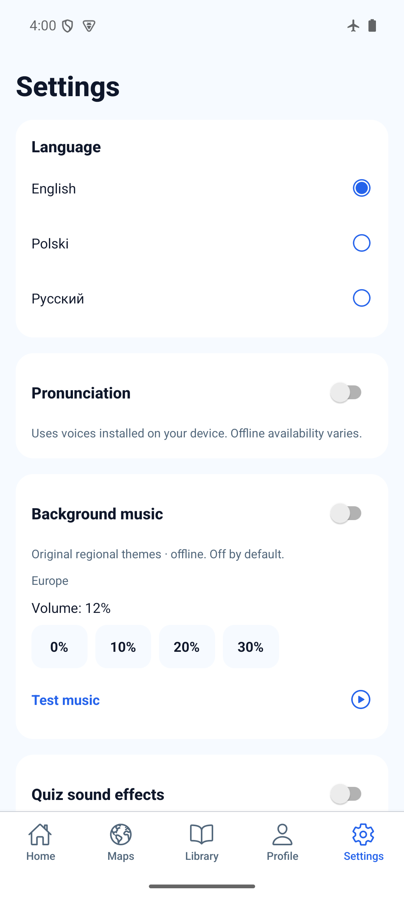
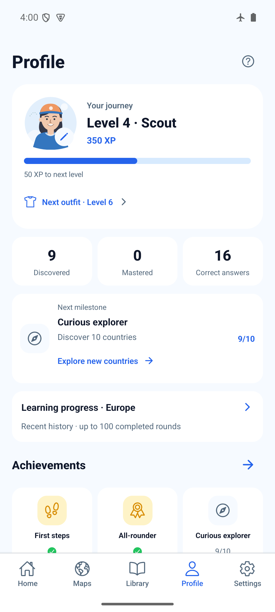

# Audio preference recovery — 2026-10-29

Source: `3a1ac7950951cc9dc0930ced0f8e23b4979be90b`, based on fetched develop
`f0e8010` (merged UI polish #54 plus Orchestrator context). This follow-up fixes
observed persistence defects: read Retry previously wrote defaults, rapid changes
used render-captured values, and writes could finish out of order. No keys,
storage shape, dependencies, audio tracks or playback policy changed.

## Automated and browser results

- `bash scripts/agent-validate.sh`: PASS (`npm ci`, TypeScript, ESLint, 148 tests
  across 40 files, Expo Doctor 21/21). Installation reports 5 low / 5 high audit
  entries; no unrelated dependency upgrade was applied.
- Five focused store tests: read failure/retry without writes, pending restore
  blocks edits, same-tick edit merging/serialized writes, latest save retry/reload,
  and stale write failure recovery.
- `npx expo export --platform web --output-dir artifacts/audio-recovery-web`: PASS.
- Serve that directory with `python3 -m http.server 8101 --bind 127.0.0.1 --directory
  artifacts/audio-recovery-web`, then run [web-smoke.js](web-smoke.js) through the
  Playwright tool: PASS, zero page errors. Uses a new isolated browser context.
- Real Settings screen: injected read failure disables edits and leaves confirmed
  preferences intact; Retry restores both enabled toggles and 20% volume. Injected
  save failure retains selected 30%; Retry persists it. Independent rapid toggles
  and 10% volume survive reload. EN/PL/RU error text now covers read and save errors.





## Android result

Built with:

```sh
JAVA_HOME=/opt/homebrew/opt/openjdk@17/libexec/openjdk.jdk/Contents/Home WORLD_MAPS_ARCHITECTURES=arm64-v8a npm run build:android:preview
adb -s emulator-5554 install -r artifacts/world-maps-preview.apk
python3 docs/evidence/audio-recovery/native-smoke.py
```

Standalone arm64 APK, embedded JS, development signing (not a store build):
`b37688868e92d9fed0205c586adb67fee23c0c2bde76dd1dbf2cbe6947b36bc2`.
Installed `base.apk` SHA-256 matches. Build source is the commit above; later
commits containing only this evidence do not change runtime code.

`world-maps-poc`, emulator-5554, Android API 35, 1080×2400, font scale 1.0,
gesture navigation 2, airplane mode 1. Actual update-over-install, no uninstall,
no storage clearing, no system preference changes.

PASS: both audio toggles changed independently and restored across force-close/
relaunch. Original settings restored and verified across another relaunch:
music off, effects off, volume 12%. Profile before/after upgrade retains 350 XP,
9 discoveries and 16 correct answers. No AndroidRuntime/ReactNativeJS errors in
sampled logcat. Emulator left running on Profile.

The initial harness restarted immediately after the final toggle and failed its
restore assertion. The final harness confirms each toggle's changed UI state
before force-stopping; that reproducible run passed. Abrupt process termination
before an asynchronous save completes is not claimed as covered.





## Remaining gates

This focused pass does not repeat the six-map/gameplay/layout regression recorded
in [market polish](../market-polish/README.md). Native storage fault injection,
audible music/speech/effects and interruptions on physical Android, screen readers
and iOS remain unverified. The asynchronous quiz-effect seek/interrupt race still
needs a separate playback-focused follow-up; this PR changes preference storage only.
