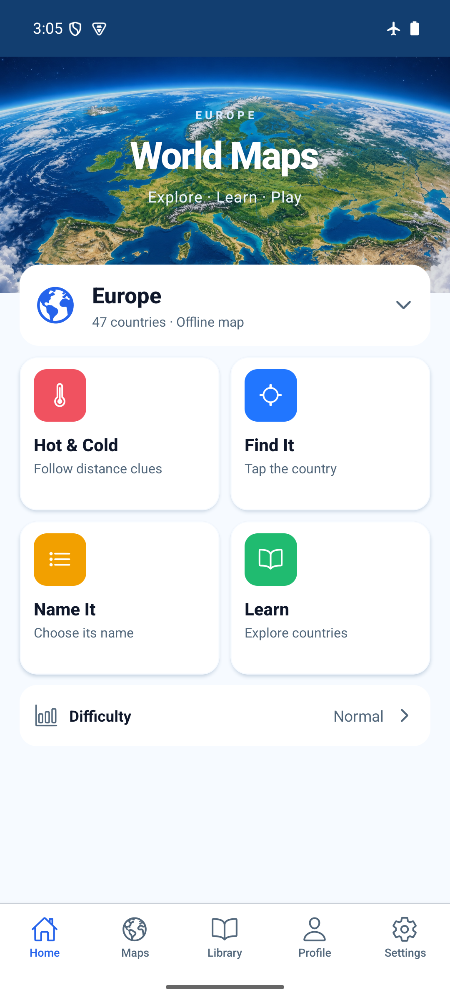
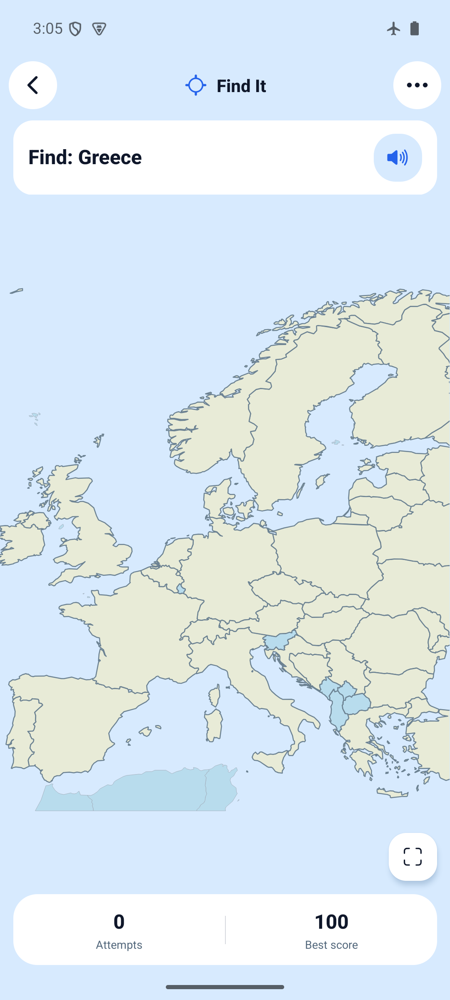

# Compact Home and map play — 2026-10-27

Implemented the approved sketch using existing components and real bundled vector
maps. Home has a smaller orbit hero, one map chooser, four direct-launch tiles and
saved difficulty. Play has continuous ocean background, clearer neutral-country
borders, Fit plus overflow tools, compact scores and completion-only Next country.
Name It hides stale choices when solved; Learn retains its compact card/details.
Route IDs, game rules, offline packs, persistence and selection guard are unchanged.

## Source and APK

Application source: `adb4070c6af2bcaa42d9ebbc4ed95bf381125891` on
`codex/compact-home-map-play`, based on `origin/develop` at `7f6a3b9`.
Subsequent evidence commits contain screenshots/docs only.

Local artifact: `artifacts/world-maps-preview.apk` (gitignored), arm64-v8a,
embedded JavaScript, development signing, not a store build.
SHA-256: `bb8570a6b1291b3b30df9c147585e955780a8c1ef7833cee55b288a47ac4119e`.

```sh
JAVA_HOME=/opt/homebrew/opt/openjdk@17/libexec/openjdk.jdk/Contents/Home \
WORLD_MAPS_ARCHITECTURES=arm64-v8a npm run build:android:preview
adb -s emulator-5554 install -r artifacts/world-maps-preview.apk
```

Build PASS. The first attempt used the host default JDK 27 and failed in native
CMake configuration; the supported JDK 17 build succeeded. No build workaround
was added to the app.

## Checks

- `npm ci`: PASS after adding test-only `@types/react-dom`; no runtime dependency.
- `npm run ci`: PASS, TypeScript, ESLint, 107 tests / 29 files. New launcher
  rendering test covers all four accessible descriptions and captions in EN/PL/RU.
- `npx expo-doctor`: PASS, 21/21.
- `git diff --check`: PASS.
- Browser: Chromium, Expo web on localhost:8081, 412×915 and 320×568. The saved
  [smoke script](web-smoke.js) runs through Playwright's `browser_run_code_unsafe`
  tool against the running server. It uses an isolated browser profile, never
  clears storage, and restores Normal after checking Easy across reload.
- Browser smoke PASS: all five chooser entries, applying map selection, saved
  difficulty, four mode launches, hidden tabs, restart/tools disclosed in options,
  no Show names assistance in an unfinished quiz, completion removes Name It
  answers, pronunciation/Next remain, Next starts a new round. No console errors.
- Browser visual checks: EN/PL/RU at small width, dark Home/play. A real 320px
  Russian completion check exposed score/Next overlap; Next now gets its own row
  on phone widths or enlarged text. The corrected screenshot is retained.

## Android evidence

AVD `world-maps-poc`, `emulator-5554`, Android API 35, arm64, 1080×2400. Installed
this APK over the previously installed version without clearing app storage.
The observed Settings summary remained 9/47 practiced, 0 mastered, 8 needing
practice, 31% accuracy immediately after upgrade; English and Normal were retained.
These observations establish continuity for those fields, not every stored record.

PASS:

- Home and all four game screens, with tabs hidden in play and restored on return.
- Find It prompt, Fit, overflow zoom/directional controls; a horizontal swipe
  left attempts at zero. Existing pan/pinch and selection implementation retained.
- Name It wrong/correct answers, compact completion, pronunciation control and
  Next country. Next starts a fresh round; the previous choices disappear.
- Learn country selection, compact facts, expanded details and Android Back.
- Offline launch and bundled facts: airplane mode was already enabled, and
  `dumpsys connectivity` reported `Active default network: none`.
- Home/play in light and dark appearance; Home and Find It at font scale 1.5.
- Gesture navigation and three-button navigation: controls above system insets.
- Modal Back dismissal. Temporary night/font/navigation settings restored to
  light, 1.0 and gesture navigation; original network configuration left intact.

Physical Android, iOS, screen-reader and audible speech testing: **PENDING**.
Progress read/save failure injection was not repeated for this presentation change;
existing recovery tests pass. No claim of store readiness.

## Screenshots

| Home | Play |
| --- | --- |
|  |  |

Additional Android evidence: [Name It](android-name.png),
[completion](android-complete.png), [Learn](android-learn.png),
[map chooser](android-map-chooser.png), [dark Home](android-home-dark.png),
[dark play](android-find-dark.png), [large-text Home](android-home-large-text.png),
[large-text play](android-find-large-text.png),
[three-button Home](android-home-three-button.png),
[three-button play](android-play-three-button.png).

Browser: [Home](web-home.png), [Find It](web-find.png), [Name It](web-name.png),
[completion](web-complete.png), [320px scrolled Home](web-home-small.png),
[320px play](web-find-small.png), [Russian Home](web-home-ru-small.png),
[Russian completion](web-complete-ru-small.png), [Polish Home](web-home-pl-small.png),
[dark Home](web-home-dark.png), [dark play](web-find-dark.png).
Web screenshots include Expo's development badge; standalone Android does not.
