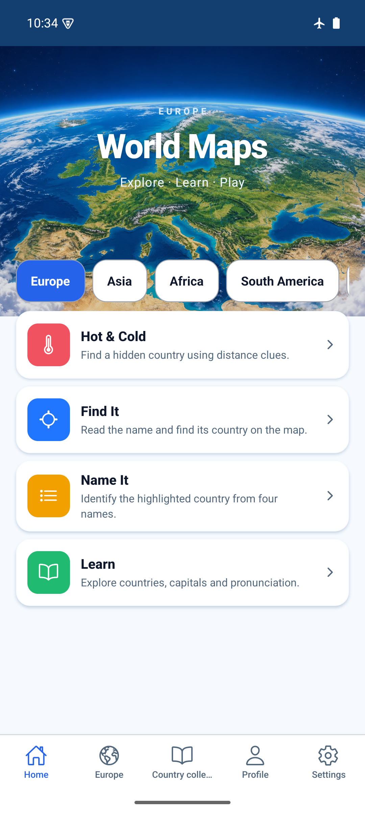
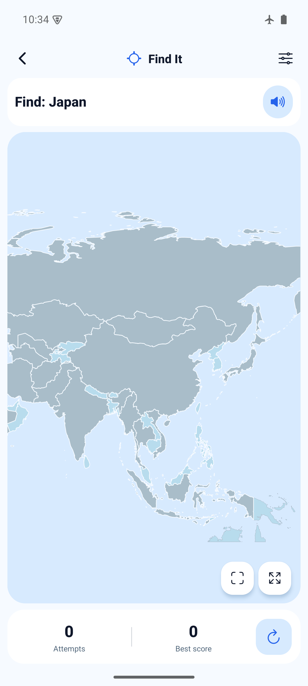
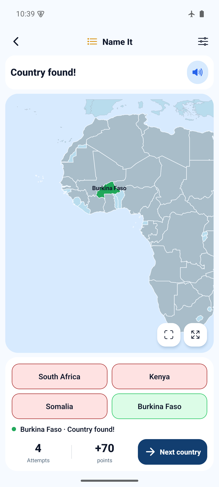
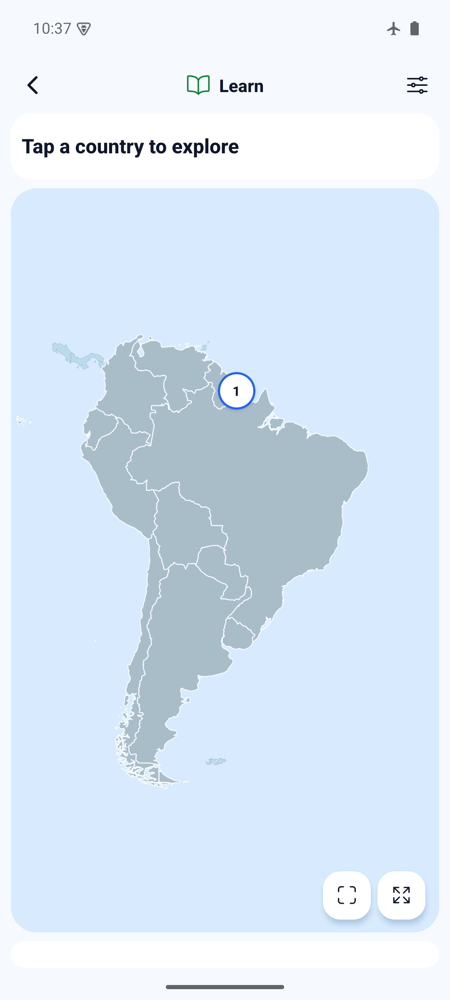
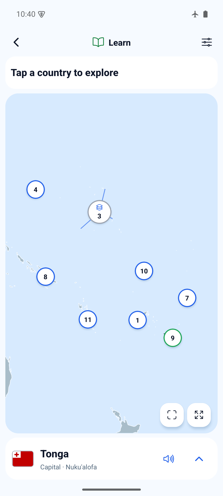

# Continent expansion evidence — 2026-10-26

Source app commit: `0655d4701edbb91f0d76a166e5f4f9e18d6217a7`.
The following documentation commit adds these notes/screenshots only.

## Automated and browser checks

- `npm run ci`: PASS, TypeScript, ESLint, 102 tests in 27 files.
- `npx expo-doctor`: PASS, 21/21 checks.
- `git diff --check`: PASS.
- Re-running `scripts/build-continent-maps.py` with the documented inputs produced
  no tracked data diff. Existing facts and new facts share the pinned input hash.
- New tests cover complete coverage/facts/flags, finite bounded geometry, every
  location pair at every difficulty, minimum answer pools, touching boundaries,
  date-line islands, Oceania picker coverage, per-pack/mode learning and scores,
  and round-trip preservation of more than 100 explorations and 47 guesses.
- Browser, 390×844: opened every new map in all four modes (16 combinations),
  dispatched polygon selections to verify country cards, expanded Oceania's
  cluster and clicked Tonga's picker. Checked PL/RU UI and names, light/dark
  appearance and new-map Hide borders (SVG stroke became transparent).
  Browser console: zero errors; three existing dependency warnings.
  Dispatched SVG selections are rendering/handler evidence, not physical taps.

## Android standalone preview

Build command:

```sh
JAVA_HOME=/opt/homebrew/opt/openjdk@17/libexec/openjdk.jdk/Contents/Home \
WORLD_MAPS_ARCHITECTURES=arm64-v8a npm run build:android:preview
adb -s emulator-5554 install -r artifacts/world-maps-preview.apk
adb -s emulator-5554 shell am start -n com.spidersu.worldmaps/.MainActivity
```

PASS. An initial attempt using `/usr/libexec/java_home -v 17` selected the only
registered JVM, JDK 27, and failed Android JDK image transformation. Explicitly
using the installed Homebrew JDK 17 resolved it; no repository workaround added.

- Artifact: `artifacts/world-maps-preview.apk` with embedded JS.
- SHA-256: `adadef23be0b54cfc8210dc98bf96e356ee8753f498f6762937e765d1e3556a1`.
- Metadata reports source `0655d47`, no tracked source changes at build time.
- arm64-v8a, development signed, package `com.spidersu.worldmaps`; not a store build.
- Emulator `emulator-5554`, API 35, arm64-v8a, 1080×2400, gesture navigation,
  light appearance. Airplane mode was already enabled and remained enabled.
- Installed over existing app with `-r`; no uninstall or storage clear.
- All 16 new continent/mode combinations opened offline. Screenshots of the four
  Learn maps were captured on `eb19b2b`; the final rebuild changed only border
  visibility handling and repeated the island-selection and toggle checks.
- Native polygon tap selected Australia. Final APK: expanded the Oceania cluster,
  tapped marker 9 and received Tonga / Nuku'alofa. Hide borders toggled without
  crashing. Native touches used UIAutomator bounds and ADB input, not JS dispatch.
- Final APK: completed Africa Name It (Burkina Faso, four attempts, 70 points).
  After force-stop/relaunch, Africa history retained one solved round / best 70.
- Existing Europe history remained 2/3/3 solved rounds and best 60/100/90 across
  Hot & Cold / Find It / Name It, before install and after cold restart. Europe
  learning remained 9/47 practiced. Default map after relaunch was Europe.
- No errors in the sampled AndroidRuntime / ReactNativeJS error log.

Not verified: physical phone, iOS, TalkBack/VoiceOver, audible pronunciation,
three-button navigation or large accessibility text in this expansion. The new
maps use vector fills; terrain imagery and translated new capital spellings are
not part of this change. This is not a full accessibility or device audit.






