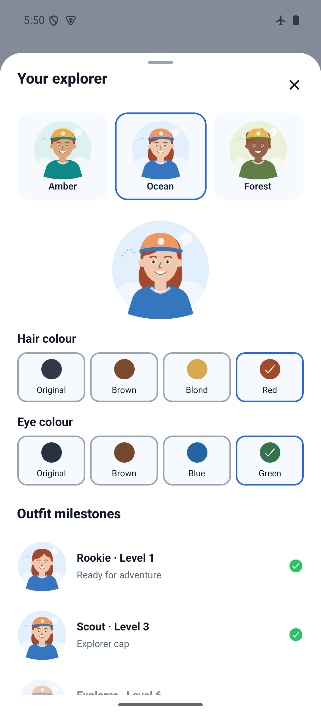
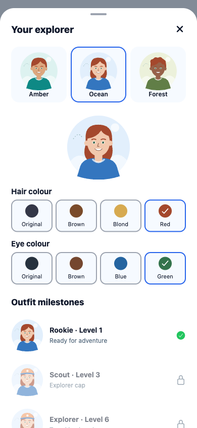
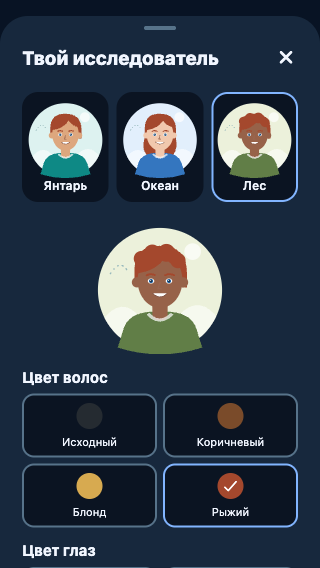
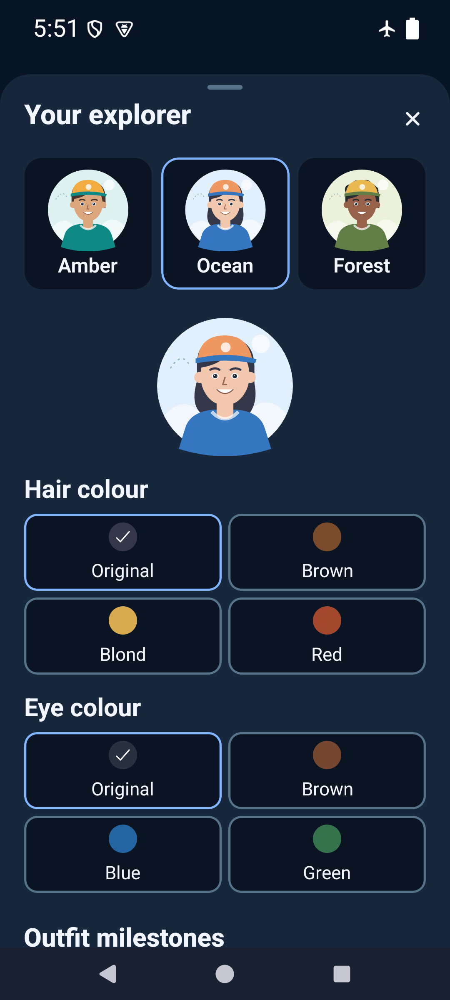

# Simple explorer colour editor — 2026-10-29

Runtime source `3cebdbc6b1049376096ee32fd81ec34ef8a89e05`, based on fetched
`develop` 8e2eca9 after #57 merged. Profile's existing explorer sheet now offers
four hair colours and four eye colours, with a live 128dp portrait. Original resets
each colour independently. Existing character choices, earned outfits and XP rules
remain; all portrait/outfit previews use the same saved appearance. No dependencies.

## Storage compatibility

Optional `explorerAppearance: { hair?, eyes? }` is an additive field on canonical
v4 progress under the existing key. Old v4 records without it retain original
colours; known IDs are validated independently, invalid values ignored. No legacy
experimental-schema migration or version bump. Six focused regressions cover old
v4 preservation, round-trip and unchanged derived rewards, invalid IDs, independent
reset, rapid edits combined with scores/save retry, and read-error write blocking.

## Source and browser checks

- `npm run ci`: PASS, TypeScript/ESLint, 155 tests / 41 files.
- `npx expo-doctor`: PASS, 21/21. Existing locked dependencies reused.
- `npx expo export --platform web --output-dir artifacts/explorer-colours-web`: PASS.
- Serve with `python3 -m http.server 8103 --bind 127.0.0.1 --directory
  artifacts/explorer-colours-web`, then run [web-smoke.js](web-smoke.js) through
  Playwright: PASS, zero page errors. New isolated browser context with an old v4
  fixture; existing browser data untouched.
- Actual SVG hair/iris fills update immediately. Rapid independent choices and base
  character changes preserve both colours across reload. Existing history,
  discoveries, settings, learning and 30 fixture XP remain unchanged. Save failure
  retains the latest choice, Retry saves it; read failure hides editing, Retry
  restores confirmed data without overwrite. Original resets only that feature.
- EN/PL/RU copy verified; 320×568 dark mode uses two columns to keep labels readable.

## Android reproduction

```sh
python3 docs/evidence/explorer-colours/native-smoke.py --baseline
JAVA_HOME=/opt/homebrew/opt/openjdk@17/libexec/openjdk.jdk/Contents/Home WORLD_MAPS_ARCHITECTURES=arm64-v8a npm run build:android:preview
adb -s emulator-5554 install -r artifacts/world-maps-preview.apk
adb -s emulator-5554 shell am force-stop com.spidersu.worldmaps
adb -s emulator-5554 shell am start -n com.spidersu.worldmaps/.MainActivity
python3 docs/evidence/explorer-colours/native-smoke.py
python3 docs/evidence/explorer-colours/native-large-text.py
```

Standalone arm64 APK, embedded JS, development signing (not store signing).
APK and installed base.apk SHA-256:
`e91ea9b643121736a451b715bfb24dbdfe83db6ba8aa8f59e13608270b225943`.

API 35, world-maps-poc / emulator-5554, 1080×2400. Actual install -r without
uninstall or storage clearing. PASS: original defaults on upgrade; hair Red and eyes Green both selectable and
retained across force-close/relaunch; 350 XP unchanged. Restored both Original
choices and verified unchanged XP after another relaunch. Native radio/text child
nodes share labels; the final harness selects checkable radio nodes for reset.

PASS: dark appearance, 150% font scale and three-button navigation; two-column
colour choices and eye controls remain reachable by scrolling. Font-scale changes
recreate the activity, so the harness opens Profile/editor after changing settings.
Restored font scale 1.0, light appearance and gesture navigation in finally;
airplane mode 1 unchanged. No sampled AndroidRuntime/ReactNativeJS errors.
 Physical Android, actual screen-reader input,
iOS, and native storage fault injection remain separate unverified gates.






