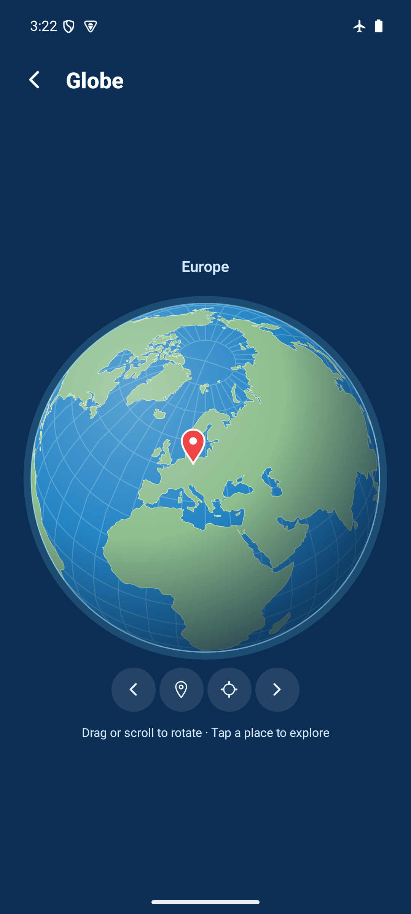
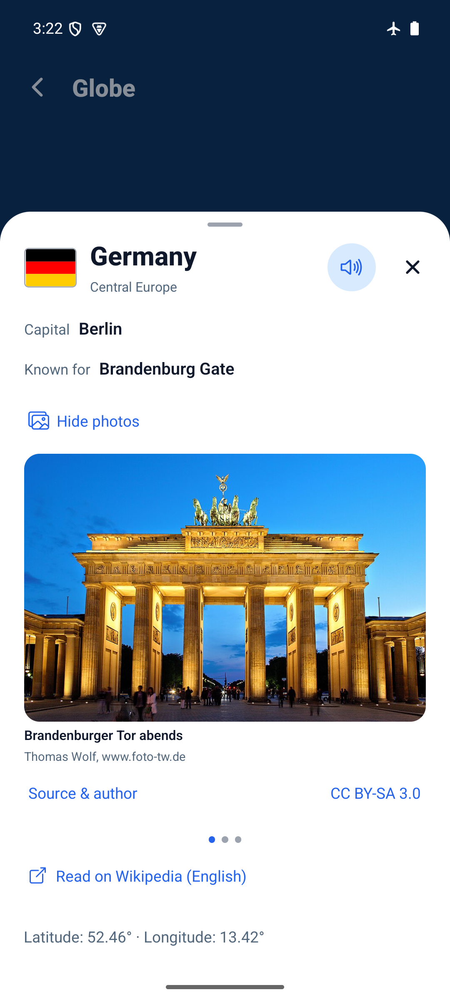
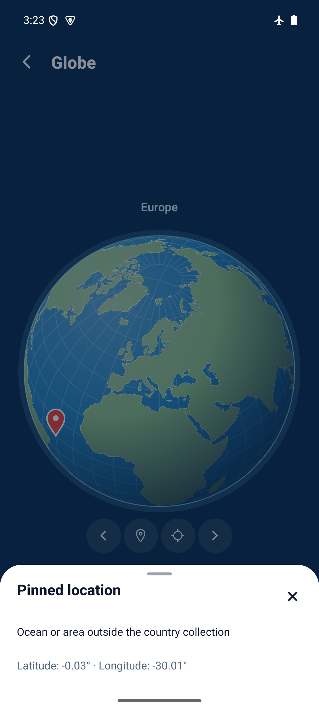
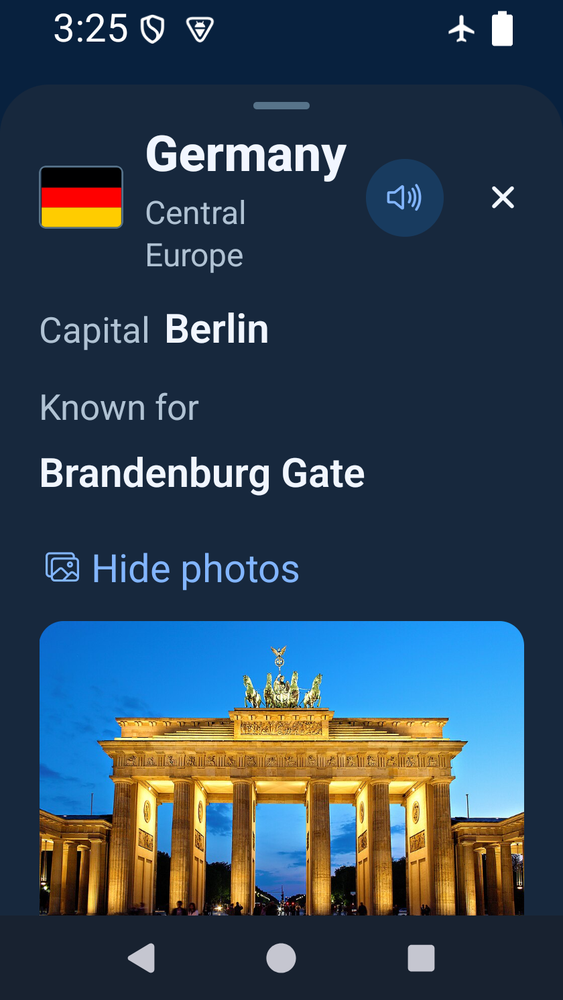

# Globe place pins — 2026-10-30

Tapping the globe drops a geographic pin and opens Learn's shared flag/country/facts/photo details. Photos start expanded. Closing keeps the pin on its geographic point; rotation moves it with the sphere and hides it on the far hemisphere. Ocean and unsupported areas show coordinates. Drag, multi-touch and cancellation cannot become a place tap. A 44dp location button, native accessibility action and web Enter/Space select the centre.

Selection inverts the orthographic projection and tests the bundled country outlines, including polygon holes and date-line wrapping. No network geocoder, nearest-country fallback, new dependency, storage key or progress writes. The coarse overview is not a precise border map: tiny marker-only countries and areas outside the bundled collection/outline coverage show coordinates. Photos retain existing network/cache/error/retry behavior.

## Checks

- `npm run ci`: PASS — TypeScript, ESLint, 216 tests / 47 files. New focused tests cover nine countries across all regions, date-line wrapping, holes, ocean/unsupported areas, projection inversion, hemisphere pin visibility and gesture cancellation/drag return.
- `npx expo-doctor`: PASS — 21/21. Dependencies unchanged; installed dependencies reused.
- `npx expo export --platform web --output-dir artifacts/globe-pin-web`: PASS.
- `python3 -m http.server 8113 --bind 127.0.0.1 --directory artifacts/globe-pin-web`, then `web-smoke.js` through Playwright: PASS — Germany by pointer, photos initially expanded, persistent/rotating pin, drag-return and outside-sphere rejection, ocean coordinates via keyboard, scroll rotation and byte-identical saved progress. Isolated browser storage; external requests blocked; zero uncaught JS errors. The harness waits for modal exit/focus restoration before keyboard input. Additional PL/RU dark 320×568 popup checks passed with visible Close.

## Android

```sh
JAVA_HOME=/opt/homebrew/opt/openjdk@17/libexec/openjdk.jdk/Contents/Home WORLD_MAPS_ARCHITECTURES=arm64-v8a npm run build:android:preview
adb -s emulator-5554 install -r artifacts/world-maps-preview.apk
python3 docs/evidence/globe-pin/native-smoke.py
```

Source `8fde8a2fdba5696a73b378bf0ea77407e799ecd8`, clean tracked runtime source at build. APK SHA-256 `84d90243db9a342eeca0eb907374778fa74d604e3391cdc7e9fa5dc141de3f8b`; installed base.apk was pulled and matched. Standalone embedded JS, arm64-v8a, development signing.

Verified emulator-5554 (`ro.kernel.qemu=1`), API 35, 1080×2400, gesture navigation. PASS: projected Berlin tap opens Germany, expanded credited cached photo, Close/Back returns to visible pin, drag does not open details, Atlantic tap gives coordinates, centre-location button opens country details, back navigation and relaunch. XP stayed 360 before/after; no discoveries or answers submitted. Airplane mode remained on. The globe's lookups/facts are offline; fresh image downloads and audible pronunciation were not tested.

Additional native check: PASS at simulated 320×568 (840×1491 physical override),
150% text, dark mode and three-button navigation: Germany popup scrolls and Close
remains inside the safe area. Original size, font, night and gesture navigation
settings were restored and verified after relaunch. Sampled AndroidRuntime and
ReactNativeJS error logs were empty.

Physical Android, iOS and real screen-reader operation remain unverified. Existing four-mode and six-map regression evidence is separate; this follow-up exercises the globe and shared popup.






