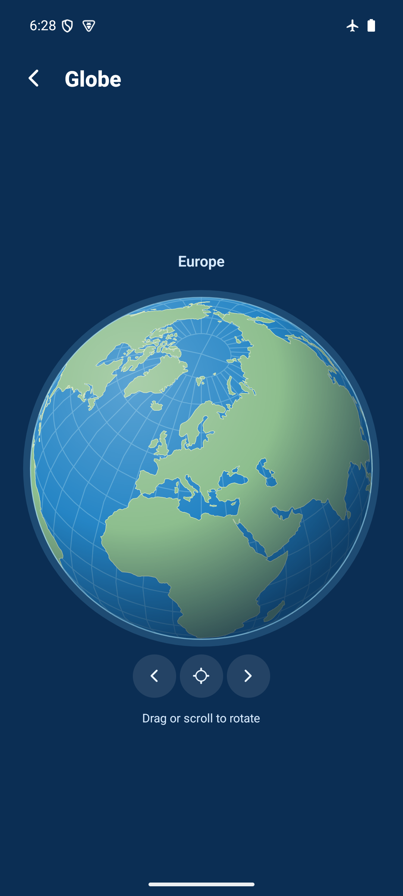
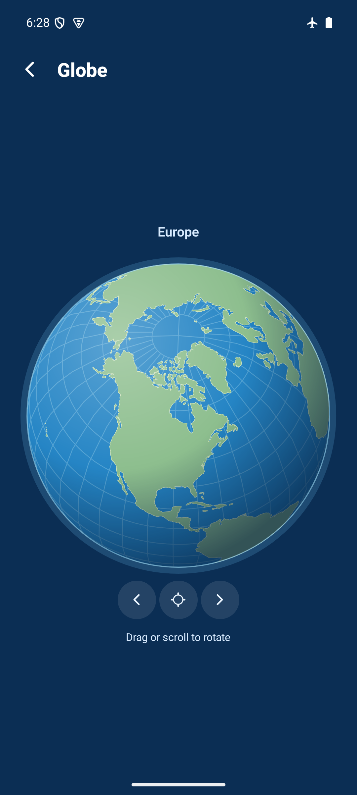
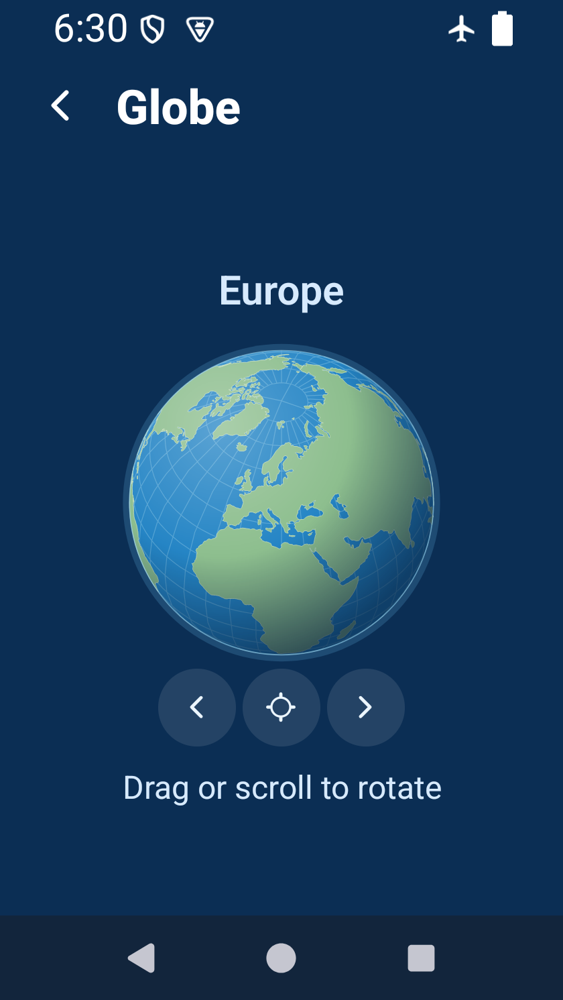
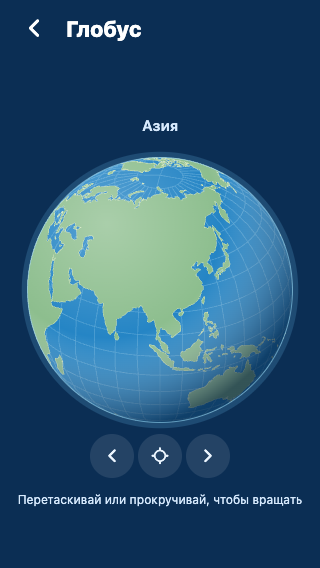

# Separate full-screen rotating globe — 2026-10-29

Runtime source `afe1e636cbd8f592ce99035851ab0f59c9903156`, based on develop 8e2eca9.
Independent of explorer editor #58 and regional relief #59.

Home's original banner remains. An “Explore the globe” card below the four mode
tiles opens a separate screen. Tabs hide; the globe screen owns top/bottom safe
areas. Header Back and Android Back restore Home/tabs. The responsive globe starts
centred on the selected region, supports two-axis touch/pointer dragging, mouse
wheel/trackpad rotation on web, arrow/Home keys, and direction/centre buttons.
No autoplay/inertia, new quiz mode, globe country selection or progress writes.
Orientation is transient. Returning/relaunching uses the selected-region start.

## Implementation and sources

`globe.ts` uses pinned pure-JavaScript d3-geo 3.1.1 for orthographic projection,
front-hemisphere/horizon clipping and graticules. Existing react-native-svg renders
land, ocean and shading. Web pointer/wheel events are isolated in a `.web.tsx`
adapter; native uses PanResponder. Updates coalesce through requestAnimationFrame.
There are no new native modules or WebGL dependencies.

Natural Earth 1:110m land v5.1.2 is bundled as 127 polygons (~87KB). Generator,
pinned URL, checksums and notices are in `scripts/build-globe.mjs`,
`data/globe-source.json` and [source/license documentation](../../licenses/globe-natural-earth.md).
No runtime downloads. Full new software notices are available offline in Settings.
Gameplay geometry/IDs, account-free operation, stored preferences and progress
schema are unchanged.

## Validation

- `npm ci` via `bash scripts/agent-validate.sh`: PASS for the changed lockfile.
  Initial lint feedback was corrected before final validation.
- Final `npm run ci`: PASS, TypeScript/ESLint, 159 tests / 41 files.
- `npx expo-doctor`: PASS, 21/21.
- Ten focused tests cover longitude wrapping, tilt bounds/invalid deltas, valid
  spherical winding and land coverage, all six region-focused hemisphere paths,
  and deterministic rotation/reset.
- `npx expo export --platform web --output-dir artifacts/home-globe-web`: PASS.
- Serve that directory on localhost port 8105 and run [web-smoke.js](web-smoke.js)
  through Playwright: PASS, zero page errors. New isolated context; external
  requests blocked. Existing browser data untouched.
- Browser checks: separate screen/tabs/Back; wheel pixels and line units; pointer
  capture/drag/cancel; keyboard tilt/rotation/reset; buttons; Name It navigation;
  selected-region focus after changing map and reload; unchanged progress; compact
  PL/RU, dark media and reduced motion. New notices in Settings were reachable and
  Close returned to Settings.

## Android reproduction and result

```sh
python3 docs/evidence/globe/native-smoke.py --baseline
JAVA_HOME=/opt/homebrew/opt/openjdk@17/libexec/openjdk.jdk/Contents/Home WORLD_MAPS_ARCHITECTURES=arm64-v8a npm run build:android:preview
adb -s emulator-5554 install -r artifacts/world-maps-preview.apk
adb -s emulator-5554 shell am force-stop com.spidersu.worldmaps
adb -s emulator-5554 shell am start -n com.spidersu.worldmaps/.MainActivity
python3 docs/evidence/globe/native-smoke.py
python3 docs/evidence/globe/native-layout.py
```

Standalone arm64 APK with embedded JS, development signing (not a store build).
APK and installed base.apk SHA-256 match:
`d73e97881473ca53df50c588a6862f566ec17422080d7a06ec72683ff820b734`.

PASS on world-maps-poc, emulator-5554, Android API 35, 1080×2400, gesture navigation,
font scale 1.0, airplane mode 1. Actual update-over-install; never uninstalled or
cleared storage. Native drag changed globe-only screenshot pixels, centre restored
identical pixels, east button rotated, Back restored tabs, reopening/relaunching
restored the selected-region view, and Profile retained 350 XP. No sampled
AndroidRuntime/ReactNativeJS errors.

PASS at simulated 320×568dp (wm size 840×1491), 150% text, dark system appearance
and three-button navigation: Back/centre/east controls remain within safe bounds
and work. Restored physical size 1080×2400, font scale 1.0, light appearance and
gesture navigation in finally. Airplane mode unchanged.

Physical-phone performance, actual TalkBack/VoiceOver interaction, iOS and native
mouse-wheel hardware remain unverified. No fps benchmark or automatic region
selection is claimed. Globe is an overview; learning/hit-testing use region maps.





