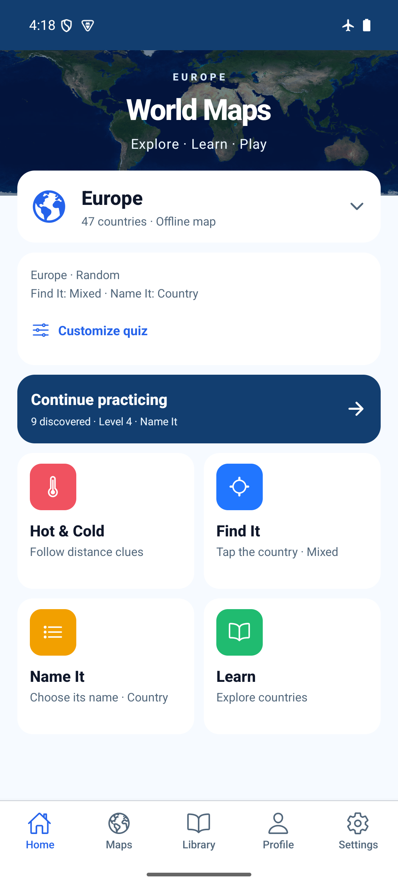
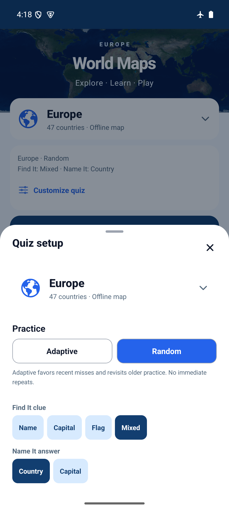
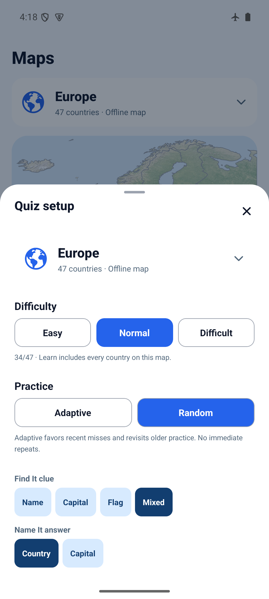

# Home difficulty cleanup — 2026-10-29

Runtime source `898c7ab9294afbf09fc9157241b49d0311801d51`.
Home hides Difficulty in its setup summary and Customize quiz sheet. Maps retains
both the saved level summary and Difficulty selector. Existing modes still use
the saved difficulty; no preference values, storage keys or gameplay rules changed.
`showDifficulty` defaults true on the shared summary/sheet; Home opts out.

## Validation

- Existing installed dependencies reused (no lockfile change in this follow-up).
- `npm run ci`: PASS, TypeScript/ESLint and 149 tests / 40 files.
- `npx expo-doctor`: PASS, 21/21.
- `npx expo export --platform web --output-dir artifacts/home-difficulty-web`: PASS.
- Serve on port 8102 with Python http.server and run [web-smoke.js](web-smoke.js)
  through Playwright: PASS, zero page errors. New isolated browser context seeds
  canonical v4 difficult/adaptive preferences; Home omits the level and selector,
  Maps retains Difficult, changing it to Easy persists through reload, and Home
  still launches Name It. Maps remains mounted offscreen, so assertions inspect
  the Home summary rather than all document text after tab switching.

Fresh standalone arm64 preview with embedded JS built using:

```sh
JAVA_HOME=/opt/homebrew/opt/openjdk@17/libexec/openjdk.jdk/Contents/Home WORLD_MAPS_ARCHITECTURES=arm64-v8a npm run build:android:preview
adb -s emulator-5554 install -r artifacts/world-maps-preview.apk
adb -s emulator-5554 shell am force-stop com.spidersu.worldmaps
adb -s emulator-5554 shell am start -n com.spidersu.worldmaps/.MainActivity
python3 docs/evidence/home-difficulty/native-smoke.py
```

APK SHA-256 and installed base.apk match:
`add63a41b39d037c51ce4c4e98034ff8a53dcb3e73af4173c1be574697c95759`.
Development signing, not store signing. Android API 35, world-maps-poc,
emulator-5554, 1080×2400, light appearance, gesture navigation, font scale 1.0,
airplane mode 1. Actual update-over-install; no uninstall/storage clearing.

PASS: Home summary omits level; Home Customize omits Difficulty and all three
level choices; system Back closes sheet; Maps Customize retains all three choices;
Back/Home restores the same active setup summary. No native preference changes.
Native dark/large-text, all-mode regression, physical Android, screen readers and
iOS were not repeated for this presentation-only change.





## Bottom-space recommendation — proposed, not implemented

Add one compact selected-continent discovery card below the mode grid: “Discover
Europe”, actual discovered/total count and a thin progress bar. “Explore
undiscovered countries” opens Library's existing Undiscovered filter for that
continent. Once complete, suggest another continent. Use existing derived map
progress; no daily challenge, new reward rules or new saved state. Keep it in the
normal scroll flow so short screens and large text retain room for mode buttons.
