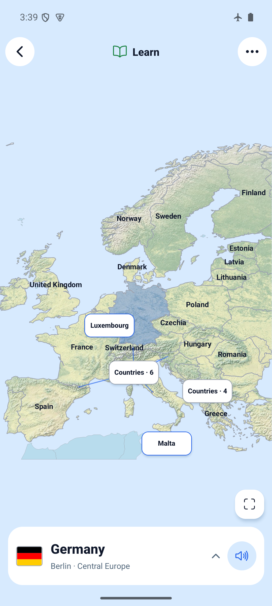
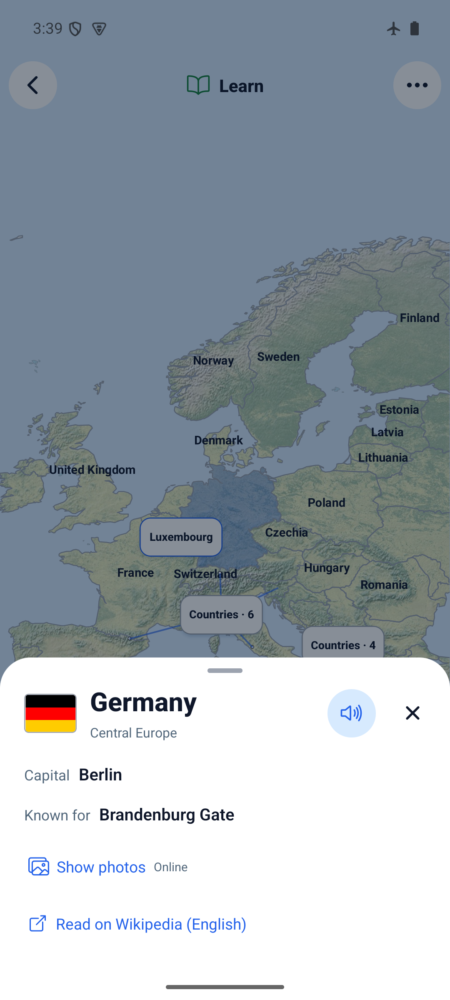

# Learn atlas UI — 2026-10-27

Application source: `f13f39c2af9fe6ab00039dea756674928f22d2b1`, on the existing
`codex/compact-home-map-play` UI branch / PR #39. Evidence commits contain docs
and screenshots only.

## Result

- A small hint replaces the instruction panel and disappears on selection.
- Learn starts with country names. Small-country controls use named chips and
  meaningful country counts; clustered controls still zoom without guessing.
- The country identity area opens details; pronunciation remains independent.
- Details contain capital, region, an optional known landmark, opt-in photos and
  one Wikipedia link. No duplicate atlas, coordinate/code tiles or repeated footer.
- Country heading, pronunciation and Close remain above scrollable details.
- Gallery controls are concise, image width is responsive, pagination reflects
  horizontal scrolling, and full photo credits/source/license links remain.
- Quiz targets remain anonymous. No new dependency, storage migration, map data
  change or network-only requirement.

## Checks

- Existing installed dependencies used; dependency files did not change.
- `npm run ci`: PASS — TypeScript, ESLint, 111 tests / 30 files.
- `npx expo-doctor`: PASS — 21/21.
- `git diff --check`: PASS.
- Focused tests cover localized country previews, absent country/landmark data,
  optional gallery mounting, technical-tile removal, picker-label collision boxes
  and wider named controls across all five maps and 80/112dp label widths.
  The latter caught a max-zoom capacity issue on short Asia maps. The fan now
  narrows labels as needed, preserving every visible location and 48dp tap height.
- [Browser smoke script](web-smoke.js): PASS at 412×915 and 320×568. Tests initial
  hint, cluster-without-selection, country essentials, no photo requests before
  opt-in (including opening details), deliberate request failure, successful retry,
  credits/license links, sticky Close after scrolling, Malta selection, gallery
  opt-in reset for another country and quiz-control anonymity.
- Browser visual checks: Polish/Russian details at 320px, dark appearance. English
  restored afterwards. Forced failed requests produce expected browser network
  errors; normal navigation had no console errors.

## Android

Fresh development-signed standalone arm64 APK, embedded JavaScript:
`artifacts/world-maps-preview.apk` (gitignored).

SHA-256: `190af70ed00e663c8a05ffee6fa12eb767d8542d2b8ce0b0fb687003dbbdba60`.

```sh
JAVA_HOME=/opt/homebrew/opt/openjdk@17/libexec/openjdk.jdk/Contents/Home \
WORLD_MAPS_ARCHITECTURES=arm64-v8a npm run build:android:preview
adb -s emulator-5554 install -r artifacts/world-maps-preview.apk
```

Build/install PASS. AVD `world-maps-poc`, `emulator-5554`, Android API 35,
arm64, 1080×2400. Installed over the preceding UI build without clearing storage.
Observed learning summary before and after: 10/47 practiced, 0 mastered,
9 needing practice, 32% accuracy. This verifies those observed fields, not all data.

Verified:

- Learn hint, country selection, named controls, compact preview and detail sheet.
- Offline facts/photo error and retry. Initial airplane mode was enabled, Wi-Fi
  disabled and `dumpsys connectivity` reported no active default network.
- Temporarily enabled emulator Wi-Fi; retry loaded the real Brandenburg Gate and
  Frankfurt photos. Horizontal swipe changed gallery position to 2/3; credits and
  license links remained visible. Native Wikimedia header/source contract retained.
- Android Back dismisses details, then returns from Learn to Home.
- 150% text (France), dark details (Germany), three-button navigation (Malta).
- Temporary font/night/navigation/Wi-Fi settings restored to the original values:
  1.0, light, gesture, Wi-Fi disabled with original `wifi_on=3`; airplane mode
  unchanged. No app storage reset.

Physical-device, iOS, screen-reader and audible speech checks remain pending.
Progress-error injection was not repeated; existing recovery tests pass. This APK
is a development-signed preview, not a store build.

## Screenshots

| Country preview | Essentials |
| --- | --- |
|  |  |

[Loaded photos](android-photos.png) · [Carousel](android-carousel.png) ·
[Offline photo state](android-offline-photos.png) · [Large text](android-large-text.png) ·
[Dark](android-dark.png) · [Three-button navigation](android-three-button.png)

Browser: [Start](web-start.png) · [Selection](web-selected.png) ·
[Details](web-details.png) · [Photos](web-photos.png) ·
[Small details with sticky Close](web-small-details.png) ·
[Polish](web-details-pl.png) · [Russian](web-details-ru.png) · [Dark](web-details-dark.png).
