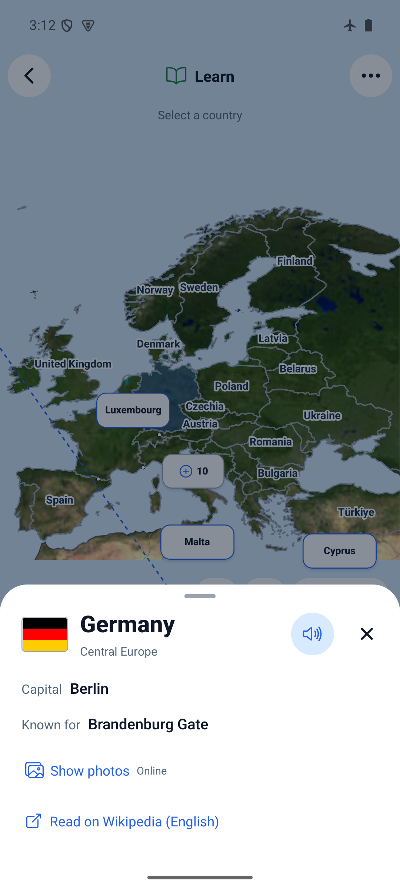
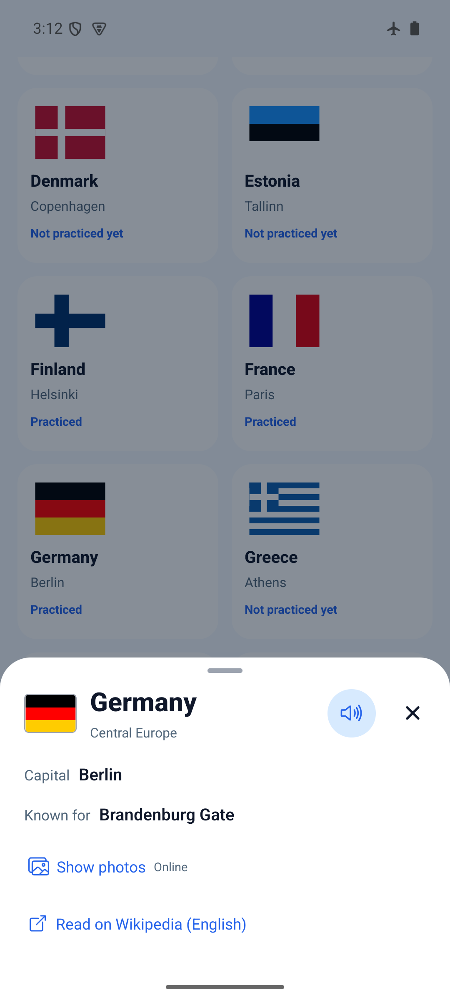

# Learn photos expanded by default — 2026-10-30

Learn's full details sheet starts with the existing photo gallery expanded. Hide/Show photos remains available; reopening details resets to expanded. Compact map cards never mount photos. Library retains opt-in photos. Countries without photos retain their article link and offline facts.

`npm run ci`: PASS (TypeScript, ESLint, 203 tests / 46 files). EN/PL/RU tests check expanded photo content, compact omission and Library's collapsed default. `npx expo-doctor`: PASS, 21/21. Dependencies unchanged; installed dependencies reused.

Fresh standalone Android build:

```sh
JAVA_HOME=/opt/homebrew/opt/openjdk@17/libexec/openjdk.jdk/Contents/Home WORLD_MAPS_ARCHITECTURES=arm64-v8a npm run build:android:preview
adb -s emulator-5554 install -r artifacts/world-maps-preview.apk
```

Runtime source: `f1df501260a00b36cf0ea7dda65001e3b0de247e`; APK SHA-256: `9abcea8c7eb109e7a0e3e0a34cc5b87a4657cf2cf4564df40fd4cc68db16d740`. Build metadata marks tracked changes because only `docs/wikipedia-gallery.md` was edited during the build; runtime source unchanged. Development signing, arm64-v8a, embedded JS.

Verified emulator-5554 (`ro.kernel.qemu=1`), API 35, 1080×2400, gesture navigation. PASS: Germany details immediately show an existing cached photo, caption and attribution; Hide/Show; close/reopen expansion; Library opt-in; system Back; existing progress survives installation and relaunch. Original Europe/map/display settings retained. Library search was changed to Germany to inspect the existing country.

Harness limitation: map geometry's accessibility bounds overlap a large Luxembourg chip. The first coordinate selection hit that chip and added Luxembourg, increasing emulator XP from 350 to 360. No storage was cleared or prior progress removed; successful final checks retained 360 XP. A subsequent coordinate selected Germany correctly.

Airplane mode remained enabled, but cached imagery rendered; this does not prove fresh network download or uncached offline failure. Those existing error/retry paths were unchanged. Full six-map/layout regression is documented in [map framing evidence](../map-framing/README.md) for the preceding runtime; this focused follow-up did not repeat it. iOS, physical devices and screen readers unverified.




