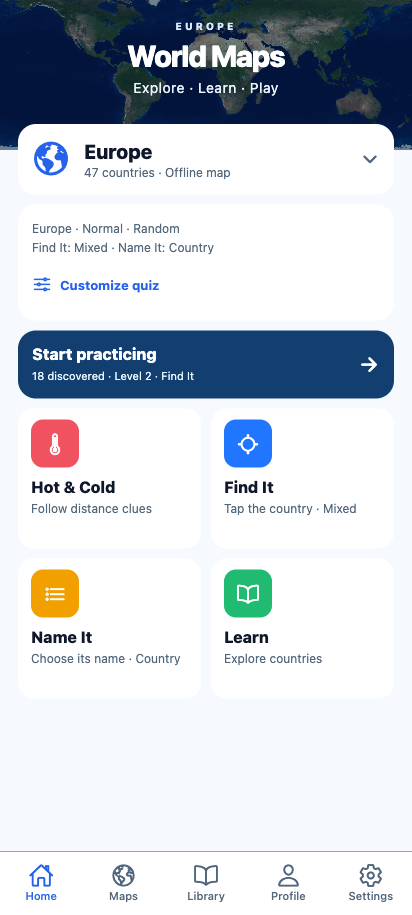
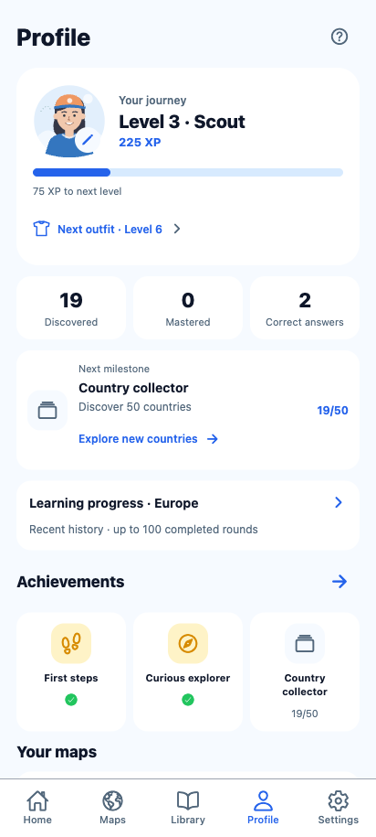

# Market UI/UX polish — 29 October 2026

The open and partial points from the UI review are implemented. Home exposes saved
setup and repeat practice; Maps launches directly; the map keeps its size through
answer feedback; Profile connects rewards to the next activity; Library uses the
shared country sheet while retaining its collection; Settings focuses on preferences.

## Implemented behavior

- Shared Customize sheet uses the existing persisted map/difficulty/practice/variant
  selectors. Home shows the active variants and uses neutral bundled world artwork.
  Continue starts a new round in the selected map's latest retained quiz family.
- Quiz prompt/dock heights depend on mode, safe height and font scale, not answer
  state. Large text scrolls inside the dock; compact phones use one-column answers.
  Result/new-round transitions reset that scroll so rewards and choices start in view.
- Zoom and Whole map stay visible. Clusters show a plus/count with gesture guidance.
  Europe uses a gentler 1.35x phone overview; other maps start at full extent and
  small highlighted quiz targets still focus closely.
- Completed results show actual earned XP, newly earned levels/outfits/badges and
  separate game points. Rewards are derived from existing saved learning; no new
  XP balance, schema, pack ID or storage key was introduced.
- Profile has a smaller explorer header, actionable milestones, and learning/history
  in a secondary sheet. Discovery goals open an Undiscovered collection with unrelated
  search/region filters cleared; quiz goals use the next missing quiz family.
- Library retains its list behind country details, including search/region/scroll.
  The existing error/retry banner is visible in both list and details.
- Native validation found that SVG country-name text intercepted taps on the names.
  A separate noninteractive SVG now lets those taps reach the original country paths.
  The `.web.tsx` adapter, gesture guard, geographic outlines and source data are retained.

## Source and artifacts

Final application source: `bb6e042df6826c0a4a96e40fa65668457fd6a188`.
Broad native checks first passed on `969c6610399fb2732d456e5b20617a06829ab110`.
The subsequent changes only give compact/large-text answers one column and reset
result/new-round dock scroll; the final APK was installed and those paths tested.
Home/Profile captures and the compact captures use the final APK; the other native
captures document the broad checks on `969c661`.

Final standalone arm64 preview: `artifacts/world-maps-preview.apk` (ignored locally),
embedded JavaScript, development signing, package `com.spidersu.worldmaps`.
SHA-256: `cae1a03349ad7b9e88c47d1c01680d03634993459f58c76bcf186963f1744371`.
The installed `base.apk` hash matched. [Machine-readable results](results.json).
No store signing, publication or merge was performed.

```sh
npm ci --no-audit --no-fund
npm run ci
npx expo-doctor
npx expo export --platform web --output-dir artifacts/market-polish-web
JAVA_HOME=/opt/homebrew/opt/openjdk@17/libexec/openjdk.jdk/Contents/Home \
WORLD_MAPS_ARCHITECTURES=arm64-v8a npm run build:android:preview
adb -s emulator-5554 install -r artifacts/world-maps-preview.apk
```

## Results

| Check | Result and bounds |
| --- | --- |
| TypeScript, ESLint, Vitest | PASS — 143 tests / 39 files |
| Expo Doctor | PASS — 21/21 |
| Production web export | PASS |
| Browser launch/setup/Flag secrecy | PASS — isolated canonical v4 fixture |
| Browser results | PASS — +20/+15 XP, level/outfit boundary, Next and retained scores |
| Browser map stability | PASS — identical SVG bounds/viewBox before/after wrong and correct answers, after initial layout settles |
| Browser Library | PASS — search and actual scroll retained across sheet close; Profile milestone clears unrelated filters |
| Browser storage failures | PASS — injected write failure shows retry in country sheet; read failure disables discovery and exposes retry; confirmed data retained |
| Browser localization/layout | PASS — 412×915 and 320×568, PL/RU setup/Home, dark/reduced-motion, restart/Continue |
| Native launch | PASS — Android API 35 `world-maps-poc`, emulator-5554, 1080×2400, airplane mode already on, no Metro reverse mapping |
| Native maps | PASS — all six Learn maps opened offline; representative country names/relief/pickers inspected |
| Native gameplay | PASS — four mode entries/Back, Name It completion and XP, Hot & Cold guess, Flag prompt without replay, direct Maps → Learn |
| Native map labels | PASS — taps on Australia and Poland names select their actual polygons; original paths remain the hit layer |
| Native stable feedback | PASS — same Europe map bounds before/after answer/result on sampled rounds |
| Native Library | PASS — real Android Back closes the country sheet; scrolled Portugal position retained |
| Native saved facts | PASS for observed fields — existing Ocean explorer and 260 XP retained on initial update; later updates/restarts retained accumulated test activity. No uninstall/reset; not an exhaustive storage audit |
| Native appearance | PASS for sampled UI — dark, 150% text, gesture/three-button; Settings bottom and licenses Back, avatar sheet |
| Final compact follow-up | PASS — simulated 320×568dp at 150% text, dark/three-button; answers remain readable in one column, map keeps 180dp, scrolled results return to XP, Next is reachable and starts a new round |

The emulator's original physical size, light mode, font scale 1.0 and gesture
navigation were restored. Airplane mode stayed enabled. Sampled AndroidRuntime /
ReactNativeJS error query returned no entries. Test-created progress remains in the
isolated emulator; existing storage was never cleared.

**Unverified in this pass:** physical Android, audible speech/music quality, actual
screen-reader operation, iOS, native storage fault injection and a full native
multi-touch pinch regression. Browser evidence does not establish offline PWA installation.

## Screenshots

| Home | Profile |
| --- | --- |
|  |  |

[Quiz result](web-reward.png) · [Setup](web-setup.png) ·
[Library sheet](web-library-details.png) · [Learning/history](web-learning.png) ·
[PL compact setup](web-setup-pl-small.png) · [RU compact dark](web-home-ru-small-dark.png) ·
[Save retry](web-save-error.png) · [Read retry](web-read-error.png).

Native: [Home](android-home.png) · [Profile](android-profile.png) ·
[Map browser](android-maps.png) · [Result](android-reward.png) ·
[Library sheet](android-library-sheet.png) · [Library after Back](android-library-back.png) ·
[Europe](android-learn-europe.png) · [North America](android-learn-north-america.png) ·
[Oceania](android-learn-oceania.png) · [Tap on Australia name](android-final-label-tap.png) ·
[Dark Profile at 150%](android-profile-dark-large.png) ·
[Compact large-text answers](android-compact-dark-large.png) ·
[Compact result after scrolling answers](android-compact-reward.png).

## Re-run browser checks

Serve the production export on loopback port 8099. The tool-driven
[smoke script](web-smoke.js) uses a new browser context and an explicit fixture;
it never resets existing browser/device storage. Its geometry/English-name lookup
is served as `smoke-data.json` in the ignored export directory:

```sh
python3 - <<'PY'
import json
from pathlib import Path
Path('artifacts/market-polish-web/smoke-data.json').write_text(json.dumps({
    'europe': json.load(open('src/features/geography/data/europe-map.json')),
    'facts': json.load(open('src/features/geography/data/country-facts.json'))['countries'],
}))
PY
python3 -m http.server 8099 --bind 127.0.0.1 --directory artifacts/market-polish-web
```

Run the script through the Playwright tool's `browser_run_code_unsafe` file argument.
Native helper/XML/log records remain local under `artifacts/evidence/market-polish/`.
