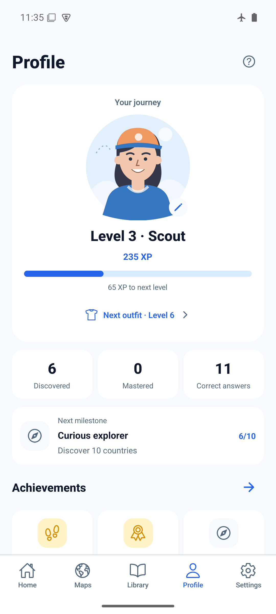
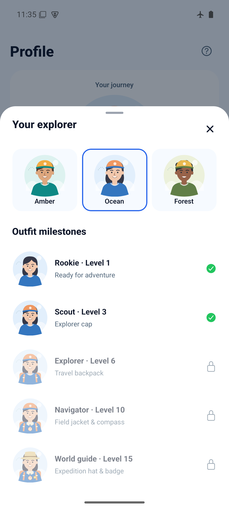

# Explorer Profile — 2026-10-27

Application source: `95da70f50a597306be1c19f9cad476ae752dd024`, branch
`codex/profile-explorer-progression`, based on develop `70684b0` (merged UI PR #39).
Evidence commits contain screenshots and this test record only.

## Delivered

One player journey across all five maps, independent of selected continent and
quiz difficulty. Three bundled human explorer choices; automatic outfit upgrades
at levels 1/3/6/10/15; six permanent milestone achievements, next goal, level bar
and map-to-Library navigation. Returning with new XP brings the level into view.

Rules: first country discovery +10 XP, solved quiz +15 XP, first-try bonus +5 XP;
every 100 XP advances one player level. Reopening countries and duplicate answer
events add nothing. Cumulative saved learning, rather than rolling score history
or current mastery, owns XP and achievements. See [rules](../../explorer-progression.md).

Schema 4 adds only the chosen cosmetic ID. Existing storage keys, pack IDs, scores,
learning, discoveries and preferences are preserved. No dependencies or services.

## Checks

- Existing installed dependencies used; package/lock files unchanged.
- `npm run ci`: PASS, TypeScript, ESLint, 121 tests / 32 files.
- `npx expo-doctor`: PASS, 21/21.
- `git diff --check`: PASS.
- New tests: v3 migration and round-trip; supported/unknown cosmetics; serialized
  avatar+score saves and failed-save recovery; duplicate discoveries/answers;
  wrong guesses; history truncation; mastery loss without reward loss; actual
  outfit thresholds; legacy quiz aliases; supported maps/records; localized copy.
- [Browser smoke](web-smoke.js): PASS, 412×915 and 320×568. The script uses a NEW
  isolated browser context and explicit v3 fixture, never existing user storage.
  Verifies migration/backfill, persisted avatar, a real Library discovery moving
  190→200 XP / level 2→3 / cap unlock, repeated-opening protection, shared XP after
  map switching, badges/outfits, small controls and dark appearance. Also injects
  unsupported future schema in that isolated context to verify read-error UI,
  hidden unconfirmed progression and preservation of the unreadable data.
- Browser visual checks: Polish/Russian avatar sheets at 320px; English restored.
  Normal Profile navigation: no console errors. A non-boolean SVG attribute warning
  found during development was fixed before the committed build.

## Android build and migration

```sh
JAVA_HOME=/opt/homebrew/opt/openjdk@17/libexec/openjdk.jdk/Contents/Home \
WORLD_MAPS_ARCHITECTURES=arm64-v8a npm run build:android:preview
adb -s emulator-5554 install -r artifacts/world-maps-preview.apk
```

Build/install PASS. Standalone arm64 APK, embedded JavaScript, development signing;
not a store build. Local artifact: `artifacts/world-maps-preview.apk` (gitignored).
SHA-256: `d8957e74cad4effe710489a230929eb0c6d340918ad05030711765ea3336042d`.

AVD `world-maps-poc`, `emulator-5554`, Android API 35, 1080×2400. Installed over the
previous schema-3 Learn build without clearing storage. Settings before/after the
initial migration retained 10/47 practiced, 0 mastered, 9 needing practice, 32%
accuracy. Profile credited the saved facts as 220 XP / level 3 Scout, 6 discoveries,
10 correct answers. These are observed fields, not a claim of a full data audit.

Verified on emulator:

- Human portrait, earned cap, level/XP bar, badge sheet, XP rules and outfit locks.
- Selected Ocean; force-close/relaunch retained it. UI XML reported the Ocean
  radio `checked=true` after restart.
- Completed a Name It round in four attempts: quiz score +70, Profile XP 220→235,
  correct answers 10→11. No first-try bonus; game score and XP are separate.
- Android Back dismisses sheets. Existing scores/preferences retained; no reset.
- 150% text, dark Profile, gesture and three-button navigation. Temporary settings
  restored to 1.0 / light / gesture. Wi-Fi/airplane configuration untouched;
  `dumpsys connectivity` reported no active default network during these tests.
- Final APK reinstalled over schema 4 retained Ocean and 235 XP. Light status-bar
  contrast was corrected and recaptured. All four mode entry/back flows checked.

Functional migration/outfit tests first ran on `199ce49`; `95da70f` adds only the
focused Profile status-bar appearance fix. Final APK and main screenshots use
`95da70f`; large-text/dark/three-button behavior was checked on the same feature
implementation before that appearance-only fix.

Physical Android, iOS, screen-reader and audible speech checks remain pending.
Emulator evidence does not establish store readiness.

## Screenshots

| Profile | Explorer choices and outfit stages |
| --- | --- |
|  |  |

[Badges](android-achievements.png) · [XP rules](android-xp.png) ·
[Quiz XP](android-quiz-xp.png) · [150% text](android-large-text.png) ·
[150% avatar sheet](android-large-avatar.png) · [Dark](android-dark.png) ·
[Three-button navigation](android-three-button.png).

Browser fixtures: [Level 2](web-profile.png) · [Earned level/cap](web-unlocked.png) ·
[Outfit stages](web-outfits.png) · [Badges](web-achievements.png) ·
[Small avatar sheet](web-avatar-small.png) · [Dark](web-dark.png) ·
[Polish](web-pl-small.png) · [Russian](web-ru-small.png).
