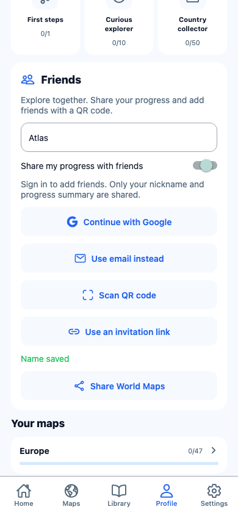
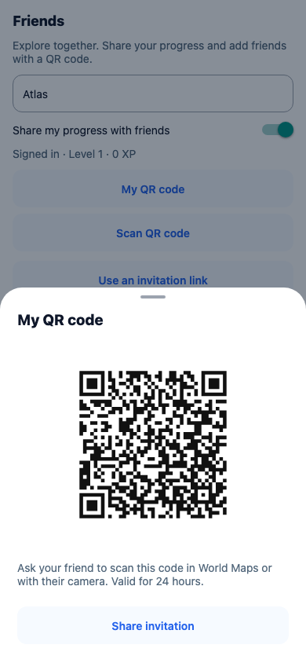
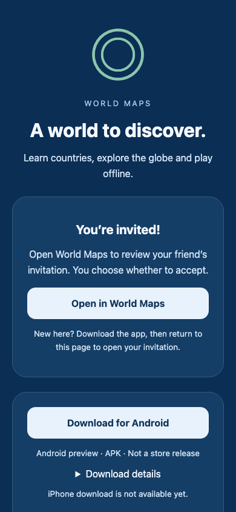

# Profile sharing and invitation flow — 2026-11-01

Profile now uses concise player-facing copy (EN/PL/RU), a collapsed email form,
My QR / Scan QR actions, a secondary link input, and explicit Add friend approval.
Async actions display localized spinners and prevent duplicate submissions. Native
share contains the actual download/invitation URL. QR generation remains offline.
Camera permission is requested only while scanning; the camera unmounts on close
or tab blur. Incoming cold/warm links route to Profile and scroll to approval,
retaining the invitation during consent/sign-in without automatically accepting it.

The main release adds `https://world-map-1.web.app` with a real Android-preview
APK download, `/friend` fallback and generated Android asset association. The
release consumes only a successful main CI artifact, verifying clean source,
SHA-256 and signing certificate. No backend/schema/progress-key changes.

## Validation

- `npm ci`: PASS after adding SDK-compatible `expo-camera` (~57.0.6).
- `npm run ci`: PASS — TypeScript, ESLint, 235 tests / 53 files.
- `npx expo-doctor`: PASS — 21/21.
- `npx expo export --platform web --output-dir artifacts/profile-sharing-web`: PASS.
- `node docs/evidence/profile-sharing/build-ui-fixture.mjs`: bundles the real
  FriendsPanel against delayed, isolated mock auth/social services. Production
  bundles never contain these mocks. It uses the existing rolldown dependency.
- `WORLD_MAPS_PLAYWRIGHT_MODULE=<installed-playwright-path> node docs/evidence/profile-sharing/web-smoke.mjs`:
  PASS — QR creation/loading, share URL payloads, decoded-QR handoff requires
  approval, acceptance/loading, friend list and unchanged sign-in requirements.
  The production web export separately checks consent, collapsed account UI and
  signed-out invitation approval. No live account creation or friendship mutation.
- `npx --yes firebase-tools@14.19.1 emulators:start --only hosting --project demo-world-maps --config artifacts/profile-hosting-config.json`
  and `landing-smoke.mjs`: PASS — real Hosting `/friend` rewrite, EN/PL/RU,
  app-opening link, download URL and invalid-invitation rejection with no external
  requests. The browser download-label test uses fixture metadata; a separate
  local hosting preparation used the actual APK/metadata and verified certificate.
- Focused tests reject wrong-source, dirty-source, tampered APK and missing
  certificate before association generation. URL tests cover custom schemes,
  legacy domains, duplicated parameters, user-info/host spoofing and native URL
  implementation differences.

## Android build

```sh
JAVA_HOME=/opt/homebrew/opt/openjdk@17/libexec/openjdk.jdk/Contents/Home \
ANDROID_HOME=/opt/homebrew/share/android-commandlinetools \
GOOGLE_SERVICES_JSON=./google-services.ci.json \
EXPO_PUBLIC_GOOGLE_WEB_CLIENT_ID=923307762389-9g278rmrjcosnnvqeavlb469bp9kk1b7.apps.googleusercontent.com \
WORLD_MAPS_ARCHITECTURES=arm64-v8a npm run build:android:preview
adb -s emulator-5554 install -r artifacts/world-maps-preview.apk
```

The ignored Android Firebase config reuses the public configuration in Mobile CI.
Runtime source: `e4945d564326b619541509ad0f30c9d8718c8cbb`, clean tracked source.
Development-signed standalone APK, embedded JS, arm64-v8a. APK SHA-256:
`8edbf793b832c82356a6103cbe9b2c9e427ccebcc77ac4835d2fcb335afd84b6`.

Verified API 35 emulator-5554, qemu=1, 1080×2400. An isolated ephemeral Android
user (10) was used for consent/camera checks; existing user 0 app storage was not
cleared or edited. Test users were removed automatically on switching back;
user 0 returned to Home with 360 XP / 10 discoveries. `native-smoke.py` is intentionally restricted to this test user.
Cold/warm custom links and a package-targeted HTTPS link open Profile approval;
Add friend stays disabled while signed out. Android's share sheet includes the
real app URL. Camera permission and loading UI were captured independently of optical scan;
preview readiness was not confirmed on the emulated pattern camera.
The first native pass found RN URL.hostname does not support custom schemes; the
parser now matches only the complete allowlisted generated URL format, without
relying on browser-only URL behavior.

## Release still required

At inspection both public Hosting roots returned 404. The deployed Android domain
association is not yet verified (`pm get-app-links` reported 1024). A source change
or successful local build does not fix that live state. Merge/release through main
must publish Hosting and the new APK; the existing CI deployment identity currently
lacks `roles/firebasehosting.admin`. That narrow grant is required before release.
Repository WIF variables are already present. Functions/rules deployment is unchanged.

Actual two-account Firebase acceptance, physical QR scanning, published download /
HTTPS app-link verification, iOS and screen-reader operation remain unverified.
The Android AVD uses an emulated pattern camera, so browser decoded-QR handoff
proof must not be described as a real camera scan. After installing from the
landing page, users return to the same invitation page and tap Open in World Maps;
there is no claimed deferred installation link service or iPhone download.




