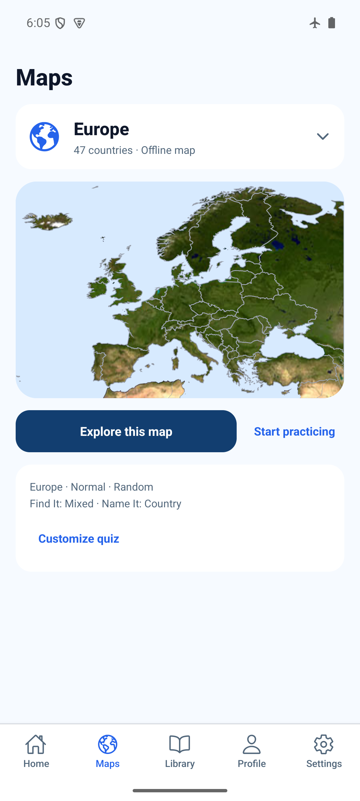
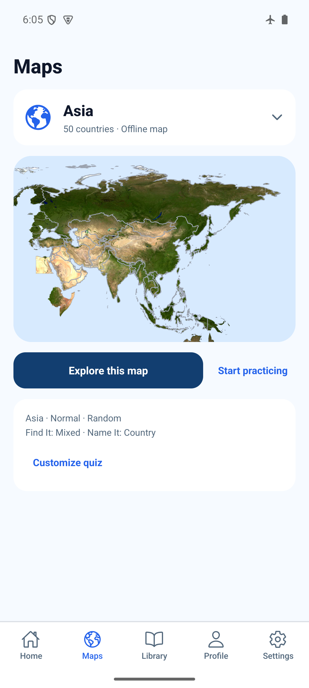
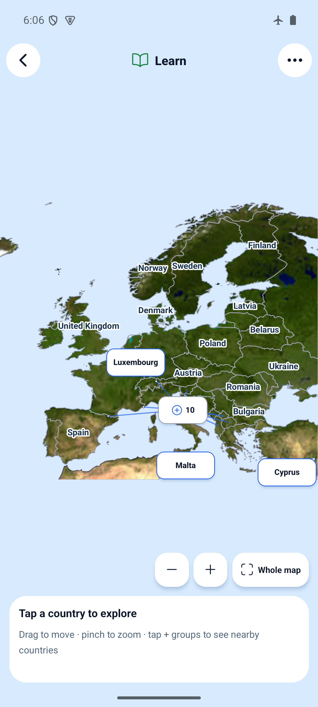
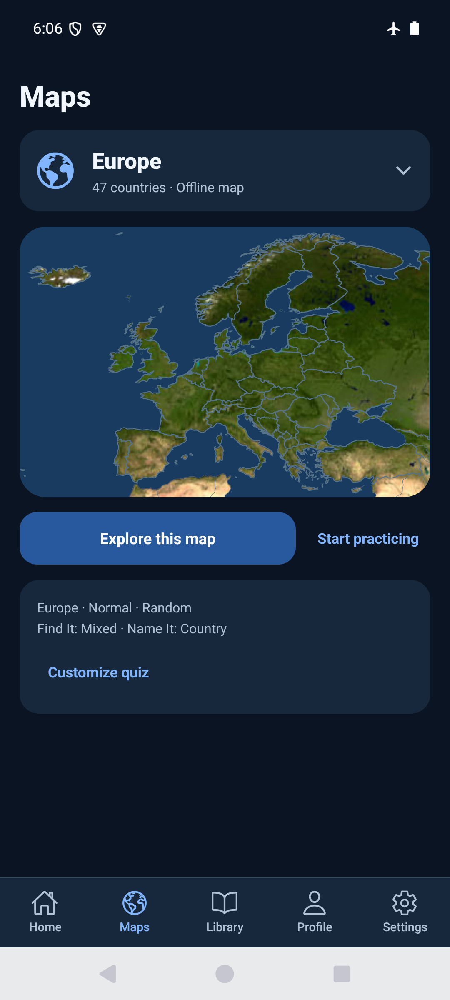

# Consistent region relief — 2026-10-29

Source: `203ac128e0a4eae67c947b28c95295cc5cfd855f`, based on develop 8e2eca9.
This is an independent map fix; explorer editor #58 is separate.

Europe previously rendered a dedicated Natural Earth raster while the other five
regions used NASA Blue Marble. All six now use the same existing bundled Blue
Marble image and clipping path. Europe gains projection metadata preserving its
original x=(longitude+26)*12 / y=(72-latitude)*15 geometry. No country geometry,
IDs, hit paths, labels, progress keys, quiz fills or dependencies changed. The old
Europe raster, generator and license metadata remain as historical sources.

## Checks

- `npm run ci`: PASS, TypeScript/ESLint, 157 tests / 40 files. Eight focused cases
  check shared clipped/noninteractive imagery across all regions, registration to
  Europe's existing axes, and terrain-free quiz fills.
- `npx expo-doctor`: PASS, 21/21. Existing installed dependencies reused.
- `npx expo export --platform web --output-dir artifacts/region-relief-web`: PASS.
- Serve with `python3 -m http.server 8104 --bind 127.0.0.1 --directory
  artifacts/region-relief-web`, run [web-smoke.js](web-smoke.js) through Playwright:
  PASS, zero page errors. Isolated browser context with external requests blocked.
- Browser verifies identical image URLs for all six previews, Europe Learn matches
  preview, keyboard country selection still opens France/Paris, Name It keeps
  neutral quiz fills, and the dark preview renders. Screenshots wait for chooser
  dismissal; assertions distinguish active Home gameplay from mounted Maps content.

## Android

```sh
python3 docs/evidence/region-relief/native-smoke.py --baseline
JAVA_HOME=/opt/homebrew/opt/openjdk@17/libexec/openjdk.jdk/Contents/Home WORLD_MAPS_ARCHITECTURES=arm64-v8a npm run build:android:preview
adb -s emulator-5554 install -r artifacts/world-maps-preview.apk
adb -s emulator-5554 shell am force-stop com.spidersu.worldmaps
adb -s emulator-5554 shell am start -n com.spidersu.worldmaps/.MainActivity
python3 docs/evidence/region-relief/native-smoke.py
```

Fresh standalone arm64 APK, embedded JS, development signing (not store signing).
APK and installed base.apk SHA-256 match:
`4d922874f76905eca417a40a6ce272737a6d1fecea151182a58d9b1acb7fbe3d`.

PASS on world-maps-poc / emulator-5554, Android API 35, 1080×2400, font scale 1.0,
airplane mode 1. Actual update-over-install, no uninstall/storage clearing. Six
native region previews captured; Europe/Asia inspected side by side. Europe Learn
shows the same terrain and readable labels; Name It retains political fills.
Dark appearance/three-button navigation inspected; light/gesture navigation restored
in finally. Selected region restored to Europe; Profile remains at 350 XP.
No errors in sampled AndroidRuntime/ReactNativeJS logcat.

Native country-tap, pinch, storage-failure, large-text and full four-mode regressions
were not repeated for this background change. Physical Android, screen reader and
iOS evidence remain unverified.





