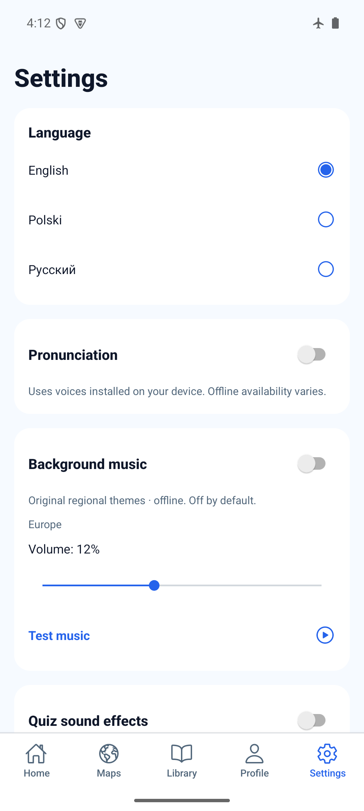
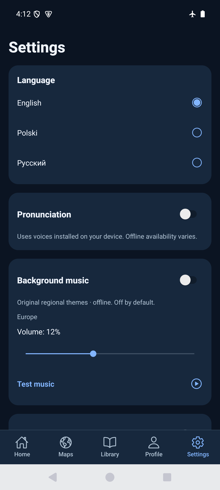
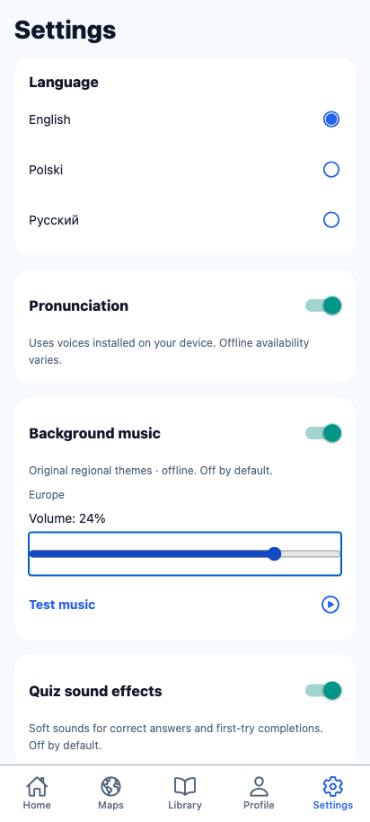

# Background music volume slider — 2026-10-29

Runtime source: `5db35803a2bd9df76207bcf5fcffa25e52e8da02`.

The four volume preset buttons are replaced by a 48dp slider, retaining the
existing 0–30% range and adding 1% steps. The current percentage remains visible.
Changes use the existing serialized audio preference store; restore/read/save
errors disable adjustment. Localized Volume labels reuse EN/PL/RU Settings copy.

Native uses `@react-native-community/slider` 5.2.0, the version pinned in Expo SDK
57's bundledNativeModules.json. This small native dependency supplies platform
slider interaction/accessibility. Web uses an HTML range for keyboard access.
Storage keys and shape are unchanged. Old audio evidence remains historical.

## Validation

- `npx expo install @react-native-community/slider`: installed pinned version.
- `bash scripts/agent-validate.sh`: PASS; after final source edits, repeated
  `npm run ci` and `npx expo-doctor`: PASS, 149 tests / 40 files, Doctor 21/21.
- Focused regression verifies rapid slider changes returning to the initial volume
  before earlier writes finish persist the final value.
- `npx expo export --platform web --output-dir artifacts/volume-slider-web`: PASS.
- Serve with `python3 -m http.server 8101 --bind 127.0.0.1 --directory
  artifacts/volume-slider-web`, run [web-smoke.js](web-smoke.js) through Playwright:
  PASS with zero page errors. New isolated context; existing browser data untouched.
- Browser: pointer drag; arrow key 1% steps; Home/End at 0/30; visible percentage;
  disabled read/save error states; recovery without data overwrite; thumb/volume
  match after reload; independent music/effects choices preserved.

## Android

```sh
JAVA_HOME=/opt/homebrew/opt/openjdk@17/libexec/openjdk.jdk/Contents/Home WORLD_MAPS_ARCHITECTURES=arm64-v8a npm run build:android:preview
adb -s emulator-5554 install -r artifacts/world-maps-preview.apk
adb -s emulator-5554 shell am force-stop com.spidersu.worldmaps
adb -s emulator-5554 shell am start -n com.spidersu.worldmaps/.MainActivity
python3 docs/evidence/volume-slider/native-smoke.py
```

PASS on `world-maps-poc`, emulator-5554, API 35, 1080×2400, font scale 1.0,
airplane mode 1. Fresh standalone arm64 APK, embedded JS, development signing.
APK and installed base.apk SHA-256 both:
`db0db013872cae496c4daae8d4f86dec2f3e162a346f41cdc02f3607b2d574d1`.
The first build overlapped source edits and was not installed as final evidence;
this hash comes from the repeat build with the recorded source held fixed.

Native SeekBar drag reached 30%, visible label matched, force-close/relaunch
retained 30%. Restored original 12% through the slider and verified after another
relaunch. Actual update-over-install; never uninstalled or cleared storage.

Light/gesture screenshot and dark/three-button screenshot show readable slider
and controls above system/tab navigation. For the latter, used `cmd uimode night
 yes` and `cmd overlay enable-exclusive --category
 com.android.internal.systemui.navbar.threebutton`; restored `night no` and
`com.android.internal.systemui.navbar.gestural` in finally. Font scale and airplane
mode unchanged. Existing game/navigation regression was not repeated.

Physical-device audio, TalkBack/VoiceOver interaction and iOS remain unverified.




