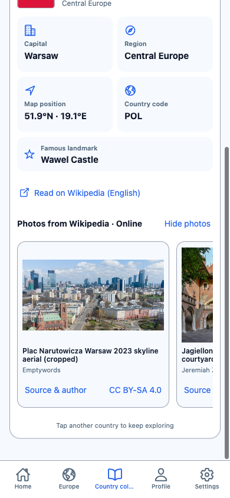
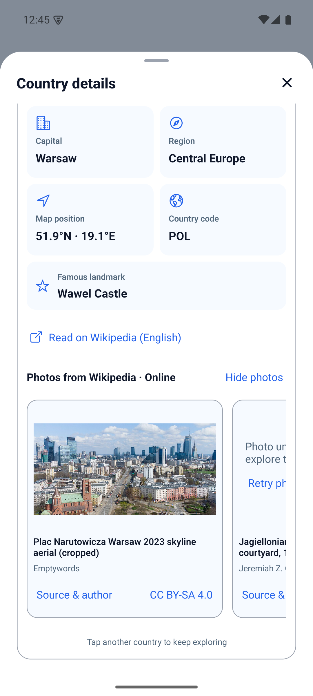
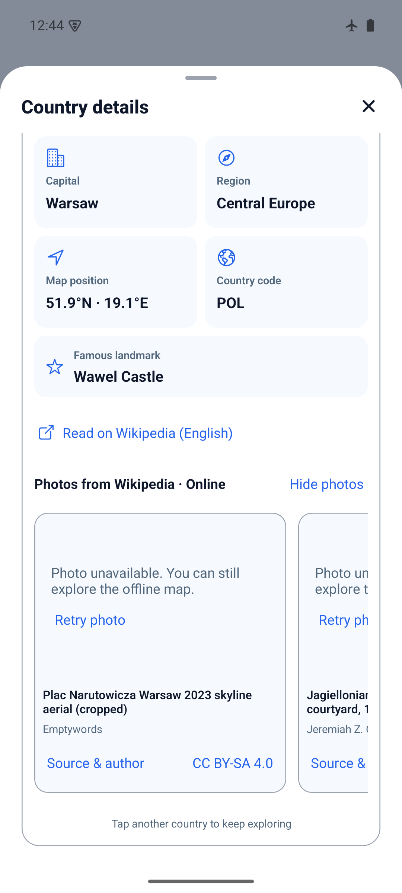

# Wikipedia gallery evidence — 2026-10-27

App source: `1ed28820a1f1f6f6334eaa856e3b0c0eaa356560`.
The following commit adds documentation/screenshots only.

## Coverage and automated checks

- Wikipedia article links for all 174 bundled country IDs.
- 394 credited photos across 172 countries, at most three per country.
  Republic of the Congo and Djibouti currently have article links only; no image
  passed the current selection/attribution requirements for those two countries.
- `npm run ci`: PASS, TypeScript, ESLint and 106 tests in 28 files. Tests check
  complete coverage, direct/disambiguated article destinations, unique file
  sources, trusted HTTPS hosts, credits, recognized license links and EN/PL/RU copy.
- `npx expo-doctor`: PASS, 21/21 checks.
- `python3 -m py_compile scripts/build-wikipedia-gallery.py`: PASS.
- Cached generator rerun: no generated data diff. `git diff --check`: PASS.
- Preparation exposed two duplicate file aliases; the generator now deduplicates
  canonical Commons source URLs. Tracking query parameters are stripped.

## Browser

390×844, current checkout via Expo web:

- No Wikimedia image requests before Show photos. Three requests after expansion.
- Poland photos loaded, with visible captions, creators and source/license links.
- Blocking Wikimedia image requests produced three Retry placeholders; unblocking
  and retrying loaded the image. Facts and navigation remained available.
- Wikipedia button passed `https://en.wikipedia.org/wiki/Poland` to the browser
  opener (mocked to avoid launching an external page). Simulated opener failure
  produced the localized inline error without crashing. Mock was restored.
- PL/RU article and gallery controls verified through Settings language switching.
- Existing collection-list issue: San Marino's bundled flag has SVG `aria-label`
  attributes which react-native-svg converts to invalid `ariaLabel` on web. This
  predates the gallery; flag data/adapters were left unchanged. Blocked image
  requests also produce the expected browser network errors during failure tests.

## Android standalone preview

```sh
JAVA_HOME=/opt/homebrew/opt/openjdk@17/libexec/openjdk.jdk/Contents/Home \
WORLD_MAPS_ARCHITECTURES=arm64-v8a npm run build:android:preview
adb -s emulator-5554 install -r artifacts/world-maps-preview.apk
```

PASS. Package `com.spidersu.worldmaps`, arm64-v8a, embedded JS, development signed.
Not a store artifact. Source `1ed2882`; SHA-256:
`bad7c31862b0a17ed37bd2a217ce29e486523036c23501cb8e76cde1e6b58f1f`.
Build metadata reports tracked changes because documentation was being updated;
no app source differed from the recorded commit.

Emulator: `emulator-5554`, API 35, arm64-v8a, 1080×2400, light appearance,
gesture navigation. Installed over the existing app, without uninstall/storage clear.

- Country collection details and the Learn details sheet show the article link and
  optional photo gallery. Compact gameplay remains unchanged.
- Final APK, airplane mode: Learn -> Poland -> details -> Show photos produced the
  offline placeholder and Retry, with facts/attribution and Close still usable.
- Initially the image server rejected generic `okhttp` requests (403). Identifying
  World Maps returned 200. The pinned RN Android object-source branch did not
  forward headers; its supported array source fixed the request. Web retains the
  object source required by React Native Web. Diagnostic logging was removed.
- Final APK, validated online Wi-Fi: retry loaded the Warsaw skyline photograph;
  its accessible ImageView and screenshot confirm native image rendering.
- Restored airplane mode 1 and the previous Wi-Fi store state 3 after the check.
- Europe history remained 2/3/3 solved and best 60/100/90 across the three quizzes.

Not verified: physical phone, iOS, screen-reader, large text, three-button navigation
or audible speech in this task. This is not a full device/accessibility audit.
The browser verified image/link failures with controlled mocks; native external
browser launching and all 394 remote photos were not individually exercised.




