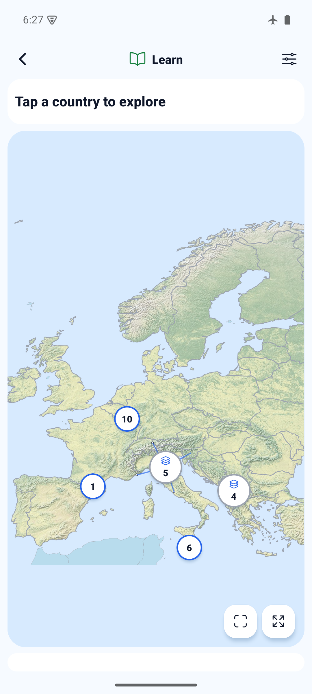
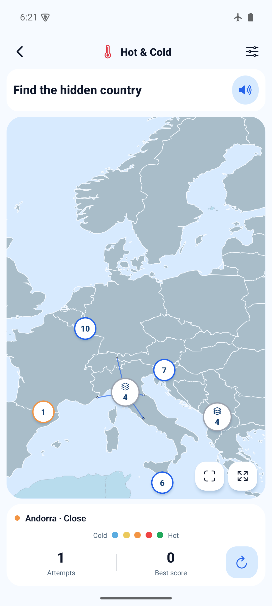
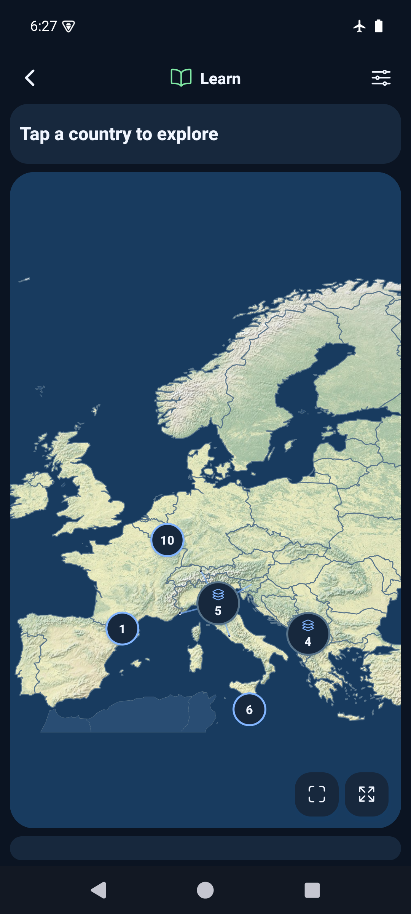

# Country picker usability — 2026-10-26

Synced from develop `11e7204`, including Explore/Profile, before implementing.

The previous picker required opening a separate sheet and matching a number back
to a small dot. This change keeps the choice on the map:

- Regular country outlines remain single-tap targets.
- The six marker countries and seven tiny polygons have visible 48dp buttons.
- Nearby buttons group instead of overlapping. A group tap zooms into its bounds
  without recording a guess. It can take another zoom in dense areas.
- At maximum zoom, individual buttons fan to free positions. Leader lines make
  the real geographic anchors explicit; polygon hit areas are never enlarged.
- Quiz targets retain their stable anonymous numbers. Only already-revealed names
  are announced. Disabled/completed and multiple-choice maps have no active picker.
- Pan/pinch starting on a target still pan/zoom; the existing guard rejects release
  presses. Keyboard country paths and non-gesture map tools remain available.

No new dependency, network service, geographic data or storage schema is added.
The implementation is deliberately local to the bundled 47-country map.

## Guidance used

- [Android touch-target guidance](https://support.google.com/accessibility/android/answer/7101858):
  recommends 48dp targets with spacing.
- [WCAG target-size guidance](https://www.w3.org/WAI/WCAG22/Understanding/target-size-minimum/):
  avoids undersized neighbouring targets; equivalent controls and geographic
  constraints require care. This is not a claim of full WCAG compliance.
- [Google Maps marker clustering](https://developers.google.com/maps/documentation/javascript/marker-clustering):
  grouping nearby markers and expanding a cluster's bounds is an established
  way to reduce overlap. We apply the pattern without introducing Google Maps.

The choice of this pattern for World Maps is an implementation decision based on
those principles; it has not been validated through a user study.

## Verification

- `npm run ci`: PASS — TypeScript, ESLint, 93 tests in 26 files.
- `npx expo-doctor`: PASS — 21/21. No dependency changes; reused installed packages.
- `npx expo export --platform web --output-dir artifacts/picker-web`: PASS.
- Pure layout regressions cover supported phone/tablet surfaces down to 280×180,
  zoom levels 1–8 and cameras centred on every small-country anchor: no missing
  visible IDs, duplicate targets, overlapping touch targets or blocked quick tools.
- Browser at 390×844 and 320×568: isolated pick, cluster zoom with zero attempts,
  repeated pick with no extra attempt, keyboard country selection, dragging from a
  marker without a guess, 48px target boxes, non-overlap, difficulty exclusion,
  Name It selection disabled, maximum-zoom targets and dark appearance checked.
- `JAVA_HOME=/opt/homebrew/opt/openjdk@17/libexec/openjdk.jdk/Contents/Home
  ANDROID_HOME=/opt/homebrew/share/android-commandlinetools
  ANDROID_SDK_ROOT=/opt/homebrew/share/android-commandlinetools
  WORLD_MAPS_ARCHITECTURES=arm64-v8a npm run build:android:preview`: PASS.
- `adb -s emulator-5554 install -r artifacts/world-maps-preview.apk`: PASS, no
  uninstall or storage clearing. API 35 arm64 emulator, 1080×2400, density 440.
- Existing solved counts 2/3/3 and best scores 60/100/90 survived update from the
  previous build. Latest develop's Explore/Profile features remain intact; a Malta
  selection appeared in Profile after cold restart (1/47 explored, 8 rounds).
- Native: direct single-tap Malta, cluster zoom with zero attempts, Andorra selection
  and repeat guard, drag starting on a marker, actual two-finger pinch, regular
  outline tap, Normal filtering and no picker in Name It: PASS. Picker bounds
  measured at 48dp. Airplane mode stayed enabled throughout.
- Light/gesture and dark/three-button layouts checked visually. Dark-mode number
  contrast was corrected after review. The final rebuild repeated the Learn picker,
  cluster and both appearances; earlier behaviour tests preceded this color-only fix.
  Restored Normal difficulty, light appearance and gesture navigation.

Preview APK: `artifacts/world-maps-preview.apk`.
Source: `05bed20be011780f181dcc6d63515bff2da16d58` with a clean tracked tree at build time.
SHA-256: `bfab2caecedaa17823e3499edb29bfd18a1f7606c6eeee13f3c3aa5738648bbe`.
arm64-v8a, embedded JS, development signing; not a store artifact. The following
commit adds documentation/screenshots only. Physical phone, iOS, TalkBack and
actual audible speech remain unverified. This is not a formal accessibility audit.

