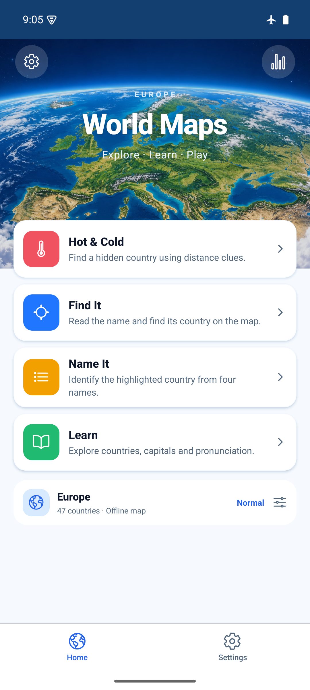
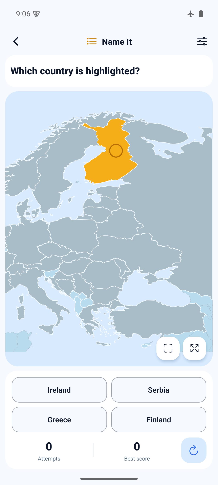
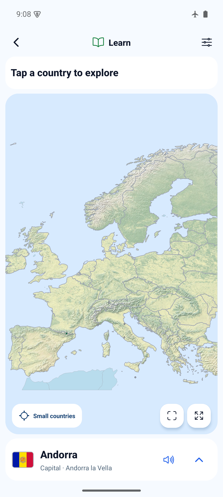
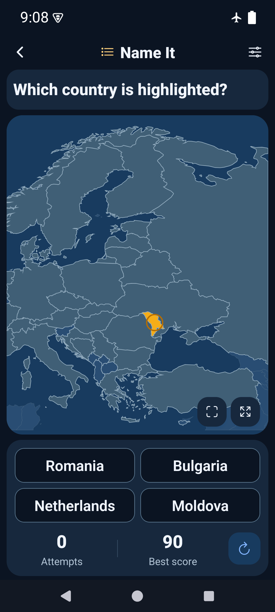

# Map-first UI — 2026-10-25

The sketch's strongest idea is a clear hierarchy: choose a mode, then play on the
map. This implementation removes the setup dashboard from Home and the repeated
instructions and permanent toolbar from gameplay.

- Home: bundled orbit artwork, four colored mode cards and one Europe/options row.
- Play: compact header/prompt, large responsive vector map, attempts/best score and
  one round action. Wrong/correct feedback stays beside the score and choices.
- Secondary controls: sheets for setup, voice/labels/borders, numbered small-country
  alternatives and full Learn details. Existing non-gesture map controls are still
  available behind Map tools; Show all Europe is always available.
- Learn: compact flag/name/capital card leaves the map visible; one tap opens the
  original full offline country facts.
- Geometry keeps equal horizontal/vertical scale. Portrait phones start closer to
  Europe; Show all Europe fits every outline. Zoom/pan helpers accept the surface
  aspect ratio, with focused unit regressions.

Rules, scoring, storage keys/schema, geographic source data, speech queue, gesture
selection guard and web SVG event adapters are unchanged. The sketch's extra
population, timer and streak displays were not added to the existing ruleset.
The [generated Home artwork and exact prompt](licenses/home-artwork.md) are
separate from the accurate gameplay geometry. Built-in image generation was used;
the final asset is `assets/artwork/europe-orbit-home.jpg` (about 628 KiB).

## Verification

- `npm run ci`: PASS — TypeScript, ESLint, 85 tests / 23 files. Three new viewport
  tests cover full-extent fitting, portrait zoom/pan scale and visible edge targets.
- `npx expo-doctor`: PASS — 21/21. Dependencies unchanged; installed dependencies reused.
- `npx expo export --platform web --output-dir artifacts/ui-refresh-web`: PASS.
- Web at 390×844: mode entry, setup disclosure, capital/flag clues and capital
  answers, actual map tap, wrong-answer disabling, scores, compact/full Learn,
  numbered small-country selection, history and Polish persistence after reload.
  Also checked 320×568, 900×700, dark appearance, keyboard country selection and
  equal map axis scales. Seventeen scripted checks passed with no page errors,
  plus explicit flag/capital-answer checks. Test preferences restored afterwards.
- `JAVA_HOME=/opt/homebrew/opt/openjdk@17/libexec/openjdk.jdk/Contents/Home
  ANDROID_HOME=/opt/homebrew/share/android-commandlinetools
  ANDROID_SDK_ROOT=/opt/homebrew/share/android-commandlinetools
  WORLD_MAPS_ARCHITECTURES=arm64-v8a npm run build:android:preview`: PASS.
- `adb -s emulator-5554 install -r artifacts/world-maps-preview.apk`: PASS, no
  uninstall or app-data clearing. API 35 arm64 emulator, 1080×2400, World Maps AVD.
- Existing 6/47 practiced records and solved counts 2/2/2 (best 60/100/90) survived
  the upgrade. Played Name It with a wrong answer then correct Finland (+90), and
  Find It using an actual Moldova map tap (+100). Both scores survived cold restart.
- Native Home, all four modes, setup/Back, Learn Andorra compact/full details,
  numbered selection, map-tool zoom/directional controls, actual pan and two-finger
  pinch: PASS. No guesses recorded during pan/pinch. Country bounds moved during
  pan and the zoomed screenshot was inspected after pinch.
- Gesture/light and three-button/dark, including 1.5 font scaling: checked visually.
  Controls and four answer choices remained reachable. Settings restored to
  gesture navigation, light appearance and font scale 1.0. Airplane mode was
  already enabled and remained enabled throughout native testing.

## Preview artifact

Local APK: `artifacts/world-maps-preview.apk`.
Source: `6edfe6e2d83bb35204e0392e910fedd250c417e2`, clean tracked tree at build time.
SHA-256: `cda2ba9a136627cecd3e05bac6e0e1a94f8f051679a31a007f21b502ef819c93`.
arm64-v8a with embedded JS and development signing; not a store artifact.
The subsequent commit adds documentation and screenshots only.

Physical-phone, iOS, TalkBack and audible speech testing remain pending. Storage
fault injection was not repeated in native UI; existing recovery unit tests pass.
No claim of store readiness or complete POC acceptance is made here.

## Android screenshots

